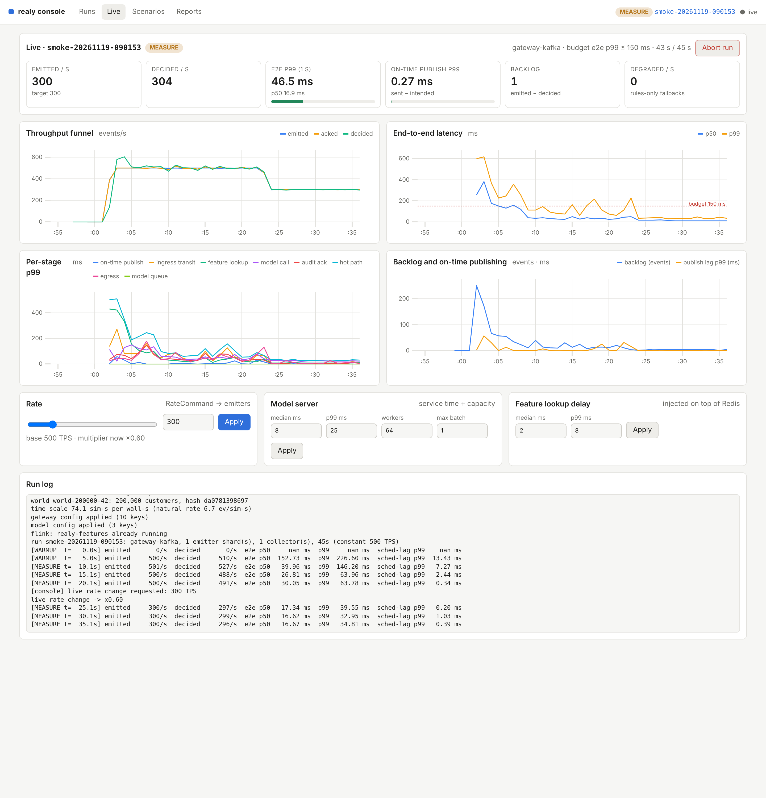

# realy

**A deterministic benchmarking and correctness instrument for real-time fraud-scoring pipelines**
(Kafka → Flink → Redis/ClickHouse → KServe/Triton). It answers: *can this pipeline hold 10k+ TPS
inside a per-event latency budget (e.g. P99 < 100 ms hot path, < 150 ms end to end) without losing
or corrupting a single decision?*

* **Synthetic payments world** — millions of customers, cards, devices, merchants and payees;
  realistic legitimate behaviour; nine fraud typologies (card testing, ATO, lost/stolen, counterfeit /
  impossible travel, merchant breach, ATM cash-out, APP scam + mules, bust-out, bot e-commerce) with
  delayed ground-truth labels. Same seed ⇒ byte-identical events.
* **Open-loop load** from 10 to 100k+ events/s, every event sent at its *intended* time and timed from
  it (coordinated-omission safe); live rate changes.
* **A real pipeline under test** — stateful Flink features on RocksDB (DSL-driven, 7 keyed stages),
  a stateless scoring gateway (sync gRPC/HTTP or async Kafka), Redis online store, KServe-v2 model
  serving (a capacity-modelling mock, or Triton on L4 with trained proxy models), CEL rules, and a
  Kafka audit WAL that ClickHouse ingests asynchronously for audit/analytics/training.
* **Per-event, per-stage latency** across all of it (in-band trace with clock domains), latency vs
  throughput curves, the knee, tail attribution, sustainability, and a PASS/FAIL verdict.
* **Correctness proofs** — no loss / duplicates, features recomputed independently (exact), CEL rule
  parity Java↔Python, score and outcome recomputation, ClickHouse audit completeness and replay.
* **Operator console** to configure, queue, schedule, watch and steer sustained runs.



## Quick start (local, docker compose)

```bash
make venv build up                 # Python venv, JVM artefacts, Kafka/Redis/ClickHouse/gateway/model/Flink
.venv/bin/realy budget smoke       # Monte Carlo: is the budget even feasible?
.venv/bin/realy run smoke          # 500 TPS, 60 s -> runs/<id>/report.{html,md,json}; exit code = verdict
.venv/bin/realy verify runs/<id>   # independent correctness checks
make ui console                    # http://localhost:8090
```
Three topologies, one scoring code path: `gateway-kafka` (async rail), `gateway-grpc` (sync,
card-auth style), `flink-inline` (Flink does everything). `realy scenarios` lists the 21 scenario
packs (fraud typologies, black-friday spike, tail stress, capacity saturation, soak, exactly-once
cost, step ramp to 10k TPS, …).

## What the local runs showed (4 vCPU container, all components on one host)

| Run | TPS | e2e p50 / p99 | hot-path p99 | Verdict |
|---|---|---|---|---|
| echo calibration (instrument floor) | 2,000 | 4.5 / 30.6 ms | 0.6 ms | PASS |
| async gateway, warm, trained proxy, 9 fraud typologies | 500 | 19.8 / 107.3 ms | 44.6 ms | PASS · recall 0.99 · FPR 3.8% · verify PASS |
| Flink-inline (fresh state) | 500 | 23.1 / 99.4 ms | 70.6 ms | PASS · features **exact** · tail = 61% keyBy shuffles |
| sync gRPC unary / bidi stream | 500 | 18.9 / 96.4 ms · 14.7 / 43.5 ms | 45.7 / 32.7 ms | PASS |
| brief's example (100 ms feature + 30–100 ms model vs 150 ms) | 1,000 | 171 / 593 ms | 162 ms | FAIL as predicted by `realy budget` |
| exactly-once sink | 500 | 5.3 s / 10.2 s | 61 ms | FAIL (visible only at checkpoint) |
| step ramp 1k → 10k | — | knee at 2k TPS, ceiling ≈ 5–6k/s on this box | — | FAIL (guardrail abort, zero loss) |

Details and design implications: [docs/latency-budget.md](docs/latency-budget.md). Proving 10k+ TPS
with headroom needs dedicated nodes: [docs/k8s-l4.md](docs/k8s-l4.md) (GKE, Strimzi, Flink operator,
KServe + Triton on NVIDIA L4).

## Repository

| Path | Contents |
|---|---|
| `contracts/` | Protobuf wire contracts, feature DSL, topics, Redis layout, generated ClickHouse DDL |
| `rules/` | Versioned CEL rule sets |
| `java/` | `scoring-core`, `scoring-gateway`, `flink-job`, `mock-model-server`, `load-emitter` (Gradle, Java 21, Flink 2.2) |
| `python/realy/` | world/generator, emitter, collector, runner, report, verify, budget, train, operator console |
| `ui/` | Operator console (React + Vite + uPlot) |
| `scenarios/` | Scenario packs (YAML) |
| `models/` | Proxy model weights + Triton model repository (ONNX MLP, XGBoost FIL) |
| `deploy/` | docker-compose stack, Dockerfiles, Kubernetes (kustomize base + `dev` + `gke-l4`) |
| `docs/` | [architecture](docs/architecture.md) · [contracts](docs/contracts.md) · [synthetic data](docs/synthetic-data.md) · [running benchmarks](docs/running-benchmarks.md) · [latency budget & results](docs/latency-budget.md) · [capacity planning](docs/capacity-planning.md) · [GKE / L4](docs/k8s-l4.md) |

## Tests

`make test` — Java (feature engine, CEL rules, latency-model fidelity, orchestrator fallbacks,
mock-model capacity/batching, Flink MiniCluster on RocksDB vs the reference engine) and Python
(world/generator determinism and typologies, reference feature engine, budget check, scenarios,
control plane, console API). CI also checks that generated code and manifests match the contracts
and schema-validates the Kubernetes overlays.
