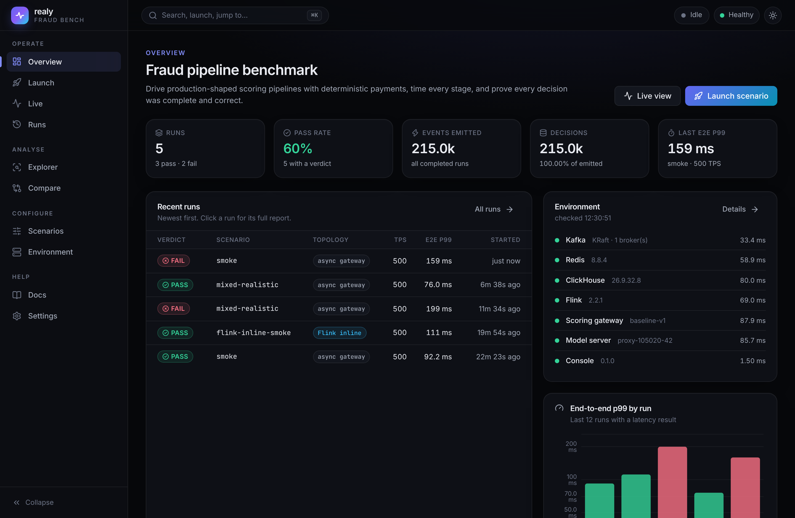
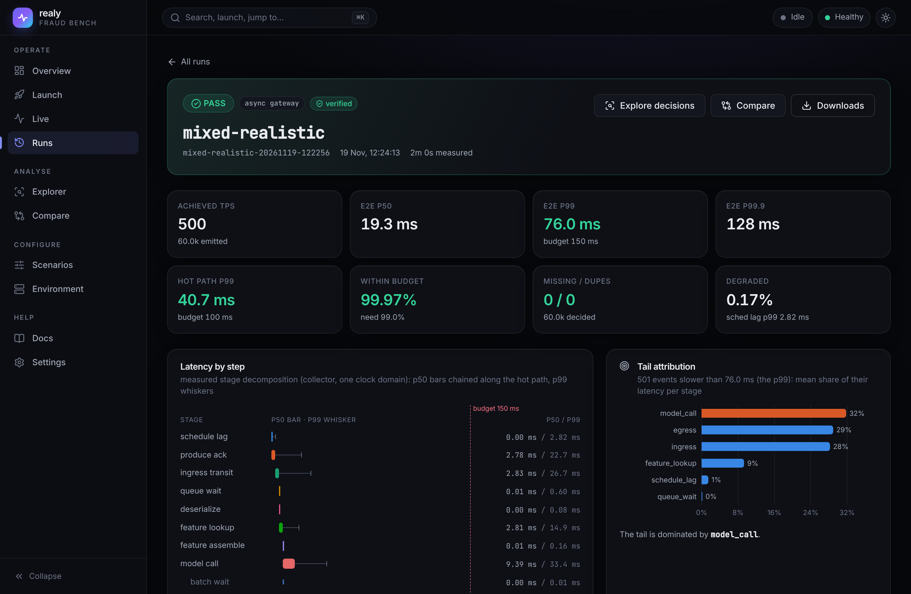
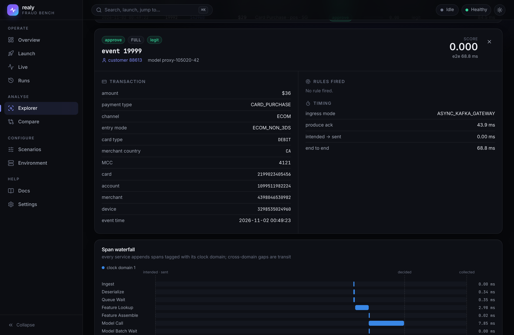
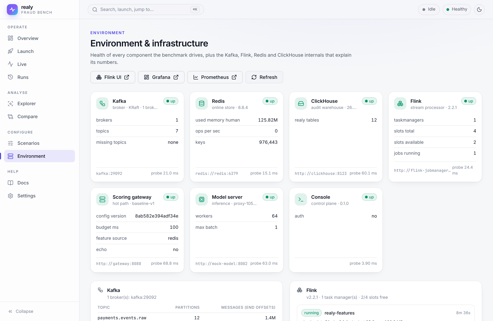

# realy

**A deterministic benchmarking and correctness instrument for real-time fraud-scoring pipelines**
(Kafka → Flink → Redis / ClickHouse → KServe / Triton). It answers one question with evidence: *can
this pipeline hold 10k+ TPS inside a per-event latency budget (p99 < 100 ms hot path, < 150 ms end to
end) without losing or corrupting a single decision?*


```bash
make up                      # builds everything from source in Docker and starts the stack
open http://localhost:8090   # launch "smoke", watch it live, read the report
```

Docker is the only requirement. To run on Kubernetes locally: `make k8s-local`
([guide](docs/deployment-kubernetes.md)).

## What you get

* **Synthetic payments world.** Millions of customers, cards, devices, merchants and payees, with
  realistic legitimate behaviour. Nine fraud typologies (card testing, account takeover,
  lost/stolen, counterfeit and impossible travel, merchant breach, ATM cash-out, APP scams with
  mules, bust-out, bots), each with delayed and noisy ground-truth labels. The same seed gives
  byte-identical events.
* **Open-loop load** from 10 to 100k+ events/s. Every event is sent at its *intended* time and
  timed from it, so measurements are safe from coordinated omission. Rate profiles are constant,
  ramp, step, spike or sine, and can be changed live.
* **A real pipeline under test:**
  * stateful Flink features on RocksDB (7 keyed stages driven by a feature DSL);
  * a scoring gateway (sync gRPC or async Kafka) and a Redis online store;
  * KServe-v2 model serving: a mock with a capacity model, or Triton on L4 with trained proxies;
  * CEL rules, and a Kafka audit WAL that ClickHouse ingests asynchronously for audit, analytics
    and training.
* **Latency per event and per stage** across all of it. Each event carries an in-band trace with
  clock domains. Reports show latency vs throughput, the knee, tail attribution, sustainability,
  and a PASS/FAIL verdict with its reasons.
* **Correctness proofs.** Each run checks for loss and duplicates and recomputes features exactly
  and independently. It also checks Java↔Python CEL rule parity, recomputes scores and outcomes, and
  verifies ClickHouse audit completeness.
* **A full operator console**, built with React and Tailwind CSS:
  * launch, queue and schedule runs;
  * watch a live topology map with events/s and p99 on every hop, plus a feed of real decisions;
  * steer a run while it executes (rate, model latency and capacity, deadlines);
  * read reports and compare runs;
  * drill into any decision (features, rules, score, label, span waterfall);
  * build scenarios visually, with the form kept in sync with the YAML;
  * check the health of every component, consumer lag, and Flink checkpoints and backpressure;
  * read these docs in the console.

| | |
|---|---|
|  |  |
|  |  |
|  |  |

## Three topologies, one scoring code path

| Topology | Rail | What consumes events |
|---|---|---|
| `gateway-kafka` | async | stateless gateway reads Kafka; Flink keeps the Redis features fresh |
| `gateway-grpc` | sync (card-auth style) | Java open-loop gRPC emitter → gateway → audit ack → response |
| `flink-inline` | async | Flink does everything: exact features, async model call, policy |

Every topology emits the same `DecisionRecord` from the same scoring code, so results are comparable
on identical inputs. `realy scenarios` lists the 21 bundled packs: fraud typologies, a Black Friday
spike, tail stress, capacity saturation, a 60-minute soak, exactly-once cost, and a step ramp to
10k TPS ([catalog](docs/reference/scenarios.md)).

## What the local runs showed (4 vCPU container, all components on one host)

| Run | TPS | e2e p50 / p99 | hot-path p99 | Verdict |
|---|---|---|---|---|
| echo calibration (instrument floor) | 2,000 | 4.5 / 30.6 ms | 0.6 ms | PASS |
| async gateway, warm, trained proxy, 9 fraud typologies | 500 | 19.8 / 107.3 ms | 44.6 ms | PASS · recall 0.99 · FPR 3.8% · verify PASS |
| Flink-inline (fresh state) | 500 | 23.1 / 99.4 ms | 70.6 ms | PASS · features **exact** · tail = 61% keyBy shuffles |
| sync gRPC unary / bidi stream | 500 | 18.9 / 96.4 ms · 14.7 / 43.5 ms | 45.7 / 32.7 ms | PASS |
| brief's example (100 ms feature + 30–100 ms model vs 150 ms) | 1,000 | 171 / 593 ms | 162 ms | FAIL as predicted by `realy budget` |
| exactly-once sink | 500 | 5.3 s / 10.2 s | 61 ms | FAIL (visible only at checkpoint) |
| step ramp 1k → 10k | n/a | knee at 2k TPS, ceiling ≈ 5–6k/s on this box | n/a | FAIL (guardrail abort, zero loss) |

Details and what they mean for a production design: [latency-budget.md](docs/latency-budget.md).
Proving 10k+ TPS with headroom needs dedicated nodes; see [k8s-l4.md](docs/k8s-l4.md) for GKE with
Strimzi, the Flink operator, and KServe + Triton on NVIDIA L4.

## Documentation

The docs are rendered in the console (**Docs**) and on GitHub.

| Start here | Concepts | Run & deploy | Reference |
|---|---|---|---|
| [Getting started](docs/getting-started.md) | [Architecture](docs/architecture.md) | [Running benchmarks](docs/running-benchmarks.md) | [Scenario schema](docs/reference/scenario-schema.md) |
| [Console guide](docs/console-guide.md) | [Contracts](docs/contracts.md) | [Docker](docs/deployment-docker.md) | [Runtime config](docs/reference/config.md) |
| [Scenarios](docs/scenarios.md) | [Synthetic data](docs/synthetic-data.md) | [Kubernetes](docs/deployment-kubernetes.md) · [GKE / L4](docs/k8s-l4.md) | [CLI](docs/reference/cli.md) · [HTTP API](docs/reference/http-api.md) |
| [Developer guide](docs/developer-guide.md) | [Latency budget](docs/latency-budget.md) | [Capacity planning](docs/capacity-planning.md) | [Features](docs/reference/features.md) · [Rules](docs/reference/rules.md) |
| | | [Operations](docs/operations.md) · [Security](docs/security.md) | [Topics](docs/reference/topics.md) · [Scenarios](docs/reference/scenarios.md) |

## Repository

| Path | Contents |
|---|---|
| `contracts/` | Protobuf wire contracts, feature DSL, topics, Redis layout, generated ClickHouse DDL |
| `rules/` | versioned CEL rule sets |
| `java/` | `scoring-core`, `scoring-gateway`, `flink-job`, `mock-model-server`, `load-emitter` (Gradle, Java 21, Flink 2.2) |
| `python/realy/` | world and generator, emitter, collector, runner, report, verify, budget, train, console API, generators |
| `ui/` | operator console (React 19, Vite, Tailwind CSS v4, Recharts) |
| `scenarios/` | scenario packs (YAML) |
| `models/` | proxy model weights and the Triton model repository (ONNX MLP, XGBoost FIL) |
| `deploy/` | one multi-target Dockerfile, the compose stack, Kubernetes (Kustomize base + components + `local` / `dev` / `gke-l4`) |
| `docs/` | guides; `docs/reference/` is generated from the code |

## Tests

* `make test` runs the Java suite:
  * feature engine, CEL rules and latency-model fidelity;
  * orchestrator fallbacks and mock-model capacity/batching;
  * a Flink MiniCluster on RocksDB.
* It also runs the Python suite:
  * world and generator determinism, and fraud typologies tripping their rules;
  * the reference feature engine, the budget check and scenarios;
  * the control plane and the console API.
* `cd ui && npm test` runs the UI tests.
* CI also builds every image with Docker alone and checks that generated code, manifests and
  reference docs match their sources. It schema-validates the Kubernetes overlays, and on demand
  runs the end-to-end smoke plus verification inside the Docker stack.
