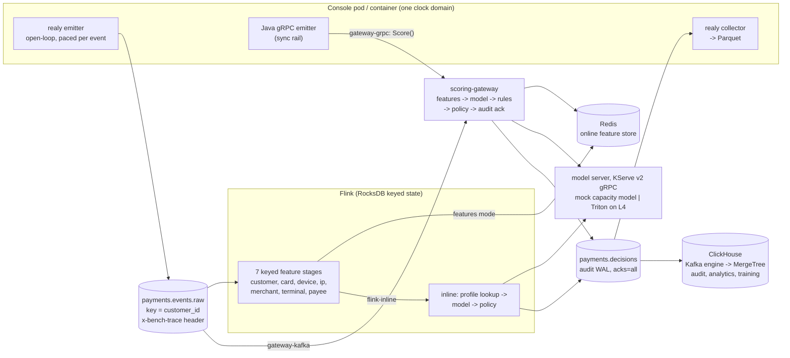
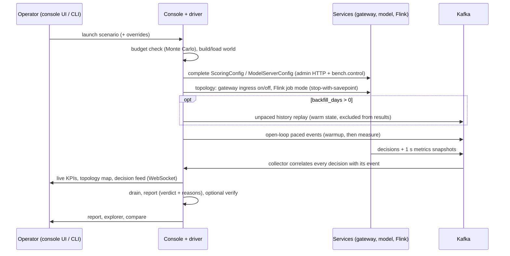

# Architecture

realy is a **measuring instrument** for real-time fraud-scoring pipelines: it drives a
production-shaped system (Kafka → Flink → Redis/ClickHouse → KServe/Triton) with deterministic
synthetic payments, times every event through every stage, and independently proves the decisions
were complete and correct.

Every topology calls the same scoring code and emits the same `DecisionRecord`. The emitter and the
collector live in one process tree on one host, so end-to-end latency is measured on one clock.
ClickHouse ingests decisions asynchronously from Kafka and is never on the hot path.

## Components

| Component | Code | Role |
|---|---|---|
| Contracts | `contracts/` | Protobuf wire formats, feature DSL, CEL rule sets, topic + storage contracts |
| Synthetic world | `python/realy/world`, `python/realy/gen` | 2M+ customers, cards, devices, merchants, payees; legitimate behaviour; 9 fraud typologies with delayed labels |
| Emitter (async rail) | `python/realy/emit` | Open-loop, per-event paced Kafka producer; stamps intended/sent time |
| Emitter (sync rail) | `java/load-emitter` | Open-loop gRPC client replaying the same compiled dataset |
| Scoring core | `java/scoring-core` | Feature engine, CEL rules/policy, KServe v2 client (micro-batching), deadline-aware orchestrator |
| Gateway | `java/scoring-gateway` | Stateless hot path: gRPC/HTTP + Kafka ingress, Kafka audit WAL before reply |
| Flink job | `java/flink-job` | DSL-driven keyed feature stages on RocksDB; modes `features` / `inline` / `both` / `echo` |
| Mock model server | `java/mock-model-server` | KServe v2 server with workers, dynamic batching, queue limit, injected faults |
| Collector / report / verify | `python/realy/collect`, `report`, `verify` | Per-event correlation, latency decomposition, verdicts, independent correctness proofs |
| Budget check | `python/realy/budget` | Monte Carlo feasibility of a budget before running |
| Operator console | `python/realy/control`, `ui/` | Run queue, schedules, live charts + live control |
| Proxy models | `python/realy/train`, `models/` | MLP → ONNX/TensorRT and XGBoost → FIL for Triton, weights JSON for the mock |

## One scoring path, three topologies

All topologies call the same `ScoringOrchestrator` (Java, `scoring-core`) and emit the same
`DecisionRecord`, so results are comparable on byte-identical inputs:

* **gateway-kafka** (async rail): gateway consumes `events.raw`; Flink (`features`) keeps Redis fresh.
* **gateway-grpc** (sync rail, card-auth style): Java emitter → gateway; the gateway mirrors the
  event to Kafka for Flink and writes the decision to the audit WAL **before** answering.
* **flink-inline** (async rail): Flink computes features exactly (ordered per key) and scores via
  async I/O. Exactly reproducible features — but every `keyBy` is a network shuffle on the hot path.

Topology switching is runtime: `bench.control` enables/disables the gateway's Kafka ingress, and the
runner switches the Flink job mode via stop-with-savepoint so RocksDB feature state stays warm.

## Run lifecycle

## Clock domains and in-band telemetry

Every event carries a `BenchTrace` (Kafka header `x-bench-trace`, or `ScoreRequest.trace`):
`t_intended` (open-loop schedule), `t_sent`, and spans appended by every service, each tagged with
its clock **domain** (host/process). Every service stamps the same clock (`Clock.systemUTC()` in
Java, `time.time_ns()` in Python, so microsecond wall time that NTP slews but never steps). An
earlier anchored-monotonic clock drifted about 10 ms from the wall clock over a long-lived JVM and
skewed cross-process spans, so it was dropped. End-to-end latency is measured in **one** domain because the
emitter and collector run on the same host (in Kubernetes: the same pod). Cross-domain spans
(ingress/egress transit) are flagged and are exact only on one host or with PTP-synced clocks.

## Correctness instruments

* completeness / duplicates per `(gen_id, seq)` bitmap (collector) and in ClickHouse (`realy verify`)
* features recomputed by a Python mirror of the Java feature engine (exact for customer/card)
* CEL rule parity (Java `dev.cel` vs Python `cel`), proxy-score recompute, outcome re-derivation
* ClickHouse audit: completeness, duplicate collapse, visibility lag, replay from stored inputs
* detection KPIs per typology and per rule against ground-truth labels

## Design decisions (and the ones the runs corrected)

1. **Flink off the synchronous path for sub-100 ms.** Measured: in flink-inline the 7 keyBy shuffles
   own ~45% of the p99 tail (see `docs/latency-budget.md`). Topology B moves them off the path at the
   cost of *feature freshness*, which the report measures as the online-store update lag
   (`online_store_update_lag_p99_ms`: Flink Kafka pickup → Redis write acknowledged).
2. **Mocks model capacity, not just delay** — workers, dynamic batching and a queue limit make
   saturation visible (`capacity-saturation` scenario); a pure sleep never fails.
3. **Budget feasibility first** (`realy budget`): the brief's 100 ms feature + 30–100 ms model vs
   150 ms is INFEASIBLE by construction (75% fallback predicted).
4. **At-least-once + idempotent decisions by default**; exactly-once is a scenario (`eos-cost`) that
   shows decisions become visible only at checkpoint commit.
5. **Audit WAL = Kafka (acks=all), ClickHouse loads asynchronously** via its Kafka engine.
   Measured cost of the synchronous audit ack: p99 ≈ 40 ms locally (27% of the sync tail).
6. **Corrected:** `fetch.max.wait.ms` is *not* a latency knob when `fetch.min.bytes=1` (the broker
   completes a pending fetch as soon as data is appended); 5 ms only caused empty-fetch churn (162% idle
   broker CPU). Now 100 ms everywhere.
7. **Corrected:** decision identity is `(run_id, event_id)`. Deterministic benchmark event ids repeat
   across runs of the same world/seed; keyed only by `event_id`, ClickHouse's ReplacingMergeTree
   silently collapsed different runs.
8. **Corrected:** the Flink job jar lives on the Flink system classpath (parent-first) in the shared
   dev cluster — JVM-wide singletons (timers, Redis client, metrics producer) otherwise leak a user
   classloader per job restart (Metaspace OOM). Kubernetes uses application mode (one cluster per job).
9. **Instrument hygiene:** the collector never batch-waits (`consume(n, t)` waits for n messages or t)
   nor busy-polls; both distort egress latency or steal CPU from the system under test.
