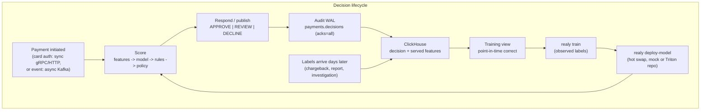
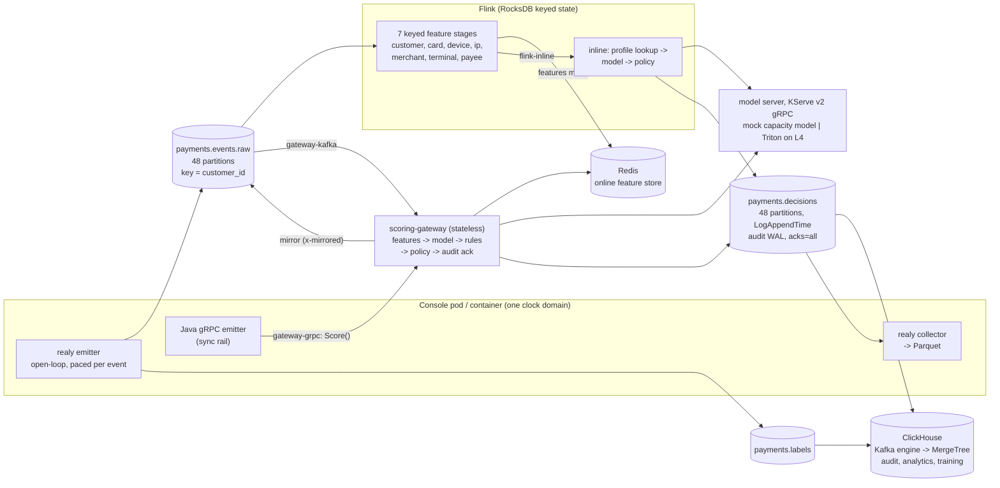
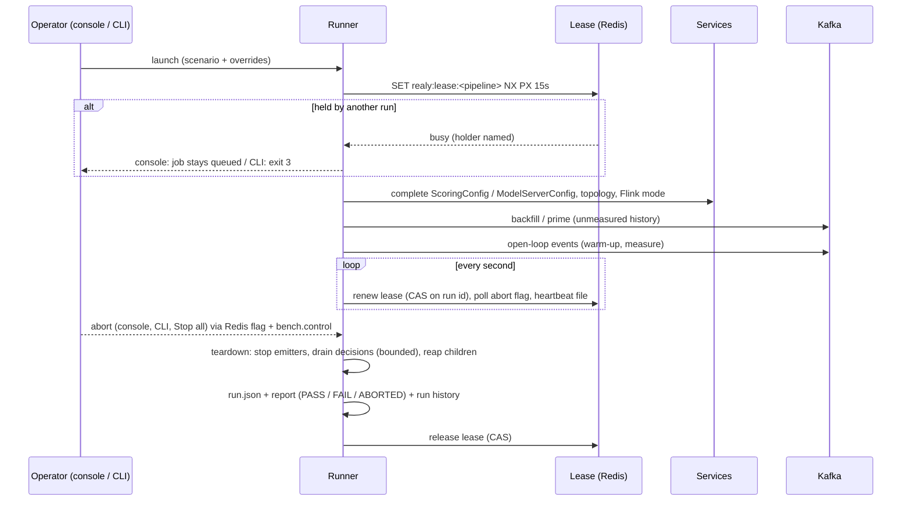

# Architecture

realy is a **measuring instrument** for real-time fraud-scoring pipelines. It drives a
production-shaped system (Kafka → Flink → Redis / ClickHouse → KServe / Triton) with deterministic
synthetic payments and times every event through every stage. It then independently proves that
the decisions were complete and correct, and that they would have caught the fraud.

This page covers the architecture end to end:
1. what each component does;
2. what happens at every stage, with exactly what goes in and comes out;
3. what Flink does in each option;
4. how Kafka keys and partitioning shape correctness and scale;
5. how the topologies compare, with measured numbers;
6. the run lifecycle and its resilience.

Companion pages:
- [feature-store-and-inference.md](feature-store-and-inference.md): one payment followed byte by
  byte through Redis, RocksDB, KServe and ClickHouse, plus state and checkpointing.
- [fraud-detection.md](fraud-detection.md): the features, rules, model, typologies and labels, and
  the out-of-sample evaluation.
- [production.md](production.md): recommendations and sizing for 10k / 20k TPS.

## 1. The system, end to end

The loop is closed inside realy itself:
- **What gets scored:** every payment is scored by the same code on whichever topology is chosen.
- **What gets kept:** every decision is kept with the exact features it was scored on.
- **Labels:** they arrive late and noisy, as they do in a bank.
- **Training:** models are trained on what was knowable at training time.
- **Redeploy and measure:** a new model is hot-swapped in and measured again, on a world it has never
  seen.

## 2. Components and their roles

| Component | Owns | Reads | Writes | Scales by |
|---|---|---|---|---|
| **Kafka** (`events.raw`, `decisions`, `labels`, `bench.*`) | ordered, replayable logs; the audit WAL | n/a | n/a | partitions (48 per hot topic), brokers (RF 3 / min ISR 2 in-cluster) |
| **Flink job** (`java/flink-job`) | per-entity window state (RocksDB), exact streaming features | `events.raw` | Redis `fs:*` (features mode), `decisions` (inline) | parallelism = slots; key groups redistribute on rescale |
| **Redis** | the online store: latest aggregates per entity, static profiles | n/a | n/a | memory; Redis Cluster shards |
| **Scoring gateway** (`java/scoring-gateway`) | the decision: deadlines, tensor, rules, policy, audit-before-reply | `events.raw` (async) or gRPC/HTTP (sync); Redis | `decisions`; mirrors sync events to `events.raw` | replicas (HPA), up to the partition count for the Kafka rail |
| **Scoring core** (`java/scoring-core`) | shared by gateway and Flink-inline: feature engine, CEL rules, policy, KServe v2 client | n/a | n/a | n/a (a library) |
| **Model server** (mock or Triton) | model math | the request tensor | n/a | replicas / GPU instances; dynamic batching |
| **ClickHouse** | the offline store: decisions with served features, labels, run history | Kafka (engine tables) | MergeTree tables, views | shards; Kafka engine consumers |
| **Emitter / collector** (`python/realy/emit`, `collect`) | open-loop load at intended times; per-event correlation | the world; `decisions` | `events.raw`, `labels`; Parquet | shards (processes) per run |
| **Console + runner** (`python/realy/control`, `runner`) | runs, queue, schedules, live control, reports, lease | everything (read-only probes) | `bench.control`; run directories; `realy.runs` | one per pipeline (the lease makes more safe) |

What each component deliberately does not do:
- the gateway keeps no state between events;
- the model server never looks anything up;
- Flink in `features` mode never decides;
- ClickHouse is never on the hot path.

Those boundaries are what make each tier independently scalable and replaceable (mock ↔ Triton,
gateway ↔ Flink-inline).

## 3. Stage by stage

### gateway-kafka (async rail; Flink keeps Redis fresh)

| # | Stage | Input | Processing (code) | Output | Why it exists | Measured (smoke, 500 TPS, p50 / p99) |
|---|---|---|---|---|---|---|
| 1 | Publish | world + scenario timeline | emitter sends each event at its intended time; stamps `x-bench-trace` (`t_intended`, `t_sent`, clock domain) | `TransactionEvent` on `events.raw`, key `customer_id` | open-loop load: a slow pipeline cannot slow the schedule (no coordinated omission) | on-time publish 0.04 / 31 ms |
| 2 | Produce ack | the record | librdkafka, `acks=all`, idempotent, `linger.ms=1`, lz4 | durable in the partition | per-customer order + durability before anyone reads it | 8.6 / 143 ms (CPU-starved host) |
| 3 | Consume | partition | gateway `KafkaIngress`: 2 consumers, up to `MAX_INFLIGHT` = 4096 events in flight; skips `x-backfill` and `x-mirrored`; commits **the lowest pending offset** only once every earlier record's decision is durable | an event to score | parallel scoring without losing ordering guarantees for commits | ingress transit 11.8 / 161 ms |
| 4 | Filters | event | CEL filters (`purchase`, `cnp_small`, `contactless`, `atm`, ...) once per event → bitmask | 64-bit mask | every aggregator reuses one evaluation | in assemble |
| 5 | Feature lookup | event's entity ids | one **pipelined** Redis round trip: `fs:{entity}:{id}` for each present entity + `pf:customer:{id}`, `pf:merchant:{id}`; per-stage deadline `feature_deadline_ms` (30) | ≤ 9 blobs | the scorer is stateless: aggregates live in Flink and are served from Redis | 4.3 / 77 ms |
| 6 | Assemble | blobs + event | `FeatureAssembler`: state blobs (customer, card) **re-windowed at the event's own time** + event applied; values blobs used as stored (`self_inclusion` adds this event to counts and sums); profiles; derived features (`amount_usd`, `is_foreign`, `dist_from_home_km`, `amount_to_avg_ratio`, `local_hour`, `credit_utilisation_24h`, ...); missing bitmap | `float[54]` in schema order | one vector shared by model, rules and audit: what was scored is what was logged | 0.02 / 1.2 ms |
| 7 | Model | `float[54]` | KServe v2 `ModelInfer`: `input__0` FP32 `[B,54]` raw little-endian, `output__0`; optional client micro-batching (`microbatch_window_us`, `microbatch_max`); optional **hedging** (`hedge_after_ms`: a duplicate on the next channel, first answer wins); Triton dynamic batching server-side; deadline `model_deadline_ms` (80) | score ∈ [0,1], model version, server queue/compute/batch size | ML on GPU, behind a stable protocol (mock ↔ Triton) | 12.8 / 83 ms (server compute 8 / 24) |
| 8 | Rules | named features + event | CEL rule set (`rules/baseline.yaml`), **all** rules evaluated and recorded | rule hits (id, action, reason) | explainable, instantly changeable policy; stops known patterns the model misses | 0.02 / 0.9 ms |
| 9 | Policy | hits + score | precedence: DECLINE rule > ALLOW rule > score ≥ decline (0.90) > REVIEW rule > score ≥ review (0.55) > APPROVE; thresholds overridable live (`ScoringConfig.review_threshold` / `decline_threshold`) | outcome + reason codes | one deterministic, auditable decision function | < 0.01 ms |
| 10 | Deadlines | elapsed time | budget from ingest (`budget_ms` 100). Feature or model deadline → **rules-only fallback** (flagged `degraded`), or `PROVISIONAL_THEN_ASYNC` (answer now, publish the final decision as revision 1), or `TIMEOUT` | a decision within budget | an answer always comes back; the cost is visible (`degraded_fraction`) | n/a |
| 11 | Audit WAL | `DecisionRecord` | Kafka `decisions`, `acks=all`, idempotent; the source offset is committed only after the ack. On failure: `SPOOL_LOCAL` (local file, replayed at restart) or `FAIL_CLOSED` (decline) | durable decision | system of record before anything downstream | append (decided → broker LogAppendTime) in ClickHouse `lat_audit_append_us` |
| 12 | Collect | `decisions` | collector correlates each decision with its event, run id, spans | Parquet per run | the instrument's view: e2e latency on one clock | egress 7.3 / 125 ms |
| 13 | ClickHouse | `decisions`, `labels`, `events.raw` | Kafka engine → materialized views → `ReplacingMergeTree` ordered by `(customer_id, run_id, event_id, revision)`; enums as names, features as `f_*` columns, rule ids, freshness, latency per stage, broker append time | `realy.decisions`, `realy.labels`, `realy.events_raw` | audit, analytics, training, independent verification | asynchronous (seconds) |
| 14 | Labels | world truth | emitted at `event_time + label_delay` (1–45 days × typology delay scale; 10% of fraud never reported; friendly-fraud chargebacks on legitimate purchases) | `FraudLabel` on `labels` | supervised learning needs labels, and real ones are late and noisy | n/a |
| 15 | Training view | decisions + labels | `v_training_dataset`: the served vector + the label + when the label became known | point-in-time training rows | no train/serve skew, no leakage from the future | n/a |

End to end at 500 TPS on this host: p50 45.9 ms, p99 278 ms when CPU-starved (a cold host with a
leftover build). On a quiet host the same scenario measures p50 19 ms / p99 76 ms; see
[latency-budget.md](latency-budget.md).

### gateway-grpc (sync rail, card authorisation)

These stages differ from the async rail:

| Stage | Difference |
|---|---|
| Ingest | the Java open-loop gRPC emitter calls `Score()` (unary, or a bidi stream) at intended times; HTTP/JSON on the same port is recorded as `SYNC_HTTP` |
| Mirror | the gateway mirrors the event to `events.raw` with `x-mirrored`: Flink folds it into state, the gateway's own consumer skips it |
| Audit before reply | the response is sent only after the audit record is durable: the `AUDIT_ACK` span (measured p99 ≈ 40 ms locally, 27% of the sync tail) |
| Latency | the client measures intended → response; ClickHouse is used for completeness |
| Abort | the emitter watches a stop file: it stops sending, drains calls in flight and writes results for the events it sent |

### flink-inline (async rail; Flink does everything)

| Stage | Processing |
|---|---|
| Source | `KafkaSource` on `events.raw`, group `realy-flink-inline` (or a per-run group for `flink_state: fresh`), no watermarks, `buffer-timeout 1 ms`, object reuse |
| Keyed features | 7 `keyBy` stages in schema order; each is a network shuffle to the subtask owning the key group, then RocksDB read → update → write |
| Skip filters | `skip-mirrored` (a sync decision already exists) and `skip-backfill` (history only feeds state) |
| Score | `AsyncDataStream.unorderedWait` (timeout 1000 ms, capacity 1000): profile lookup in Redis, the same `ScoringOrchestrator` as the gateway, the KServe call; an async timeout → REVIEW (`ASYNC_TIMEOUT`) |
| Sink | `KafkaSink` to `decisions` (at-least-once; exactly-once with a transactional id prefix) |

Features here are **exact by construction**: there is no store lag, because the stream features are
computed in the same task that scores. Measured: verify PASS, 100% customer/card agreement. The
price is that the shuffles sit on the decision path; measured, 42% of the p99 tail is keyBy shuffles.

### echo-kafka (calibration)

The gateway consumes `events.raw` and decides immediately (`ScoringConfig.echo`): no features, no
model. It measures the instrument's own floor, the Kafka round trip plus the driver.
- **Measured:** p50 4.5 ms / p99 30.6 ms at 2,000 TPS.
- **Flink:** untouched by this topology. The Flink job's own `--mode echo` is a separate
  calibration mode, and no bundled topology uses it.

## 4. What Flink does in each option, and why

| Option | Flink mode | What Flink does | What Flink never does | Why |
|---|---|---|---|---|
| gateway-kafka | `features` | keeps every entity's window state in RocksDB and writes each updated entity blob to Redis (state blobs for customer/card) | decide; read Redis | keeps shuffles and state I/O **off the decision path**; the gateway reads results in one round trip |
| gateway-grpc | `features` | the same, from the mirrored events | see sync requests | sync authorisation needs request/response, which Flink cannot give |
| flink-inline | `inline` or `both` | features **and** the decision: async model call, policy, decisions sink (`both` also writes Redis) | answer synchronously | exact features with no store; async use cases (risk on transfers, post-auth review) |
| echo-kafka | untouched | nothing new | n/a | calibration of the instrument |

The details that matter:
- **Seven keyed stages, sequentially,** one per entity in schema order.
  - **Why `keyBy`:** it is the only way to give every entity exactly one owner, so its state is
    consistent.
  - **Why so many shuffles:** each entity has its own key space, so a single `keyBy` cannot serve
    them all. The cost is 7 shuffles per event (measured per stage: `shuffle_<entity>`,
    `state_<entity>`).
- **Events without the entity** (no device, no payee, ...) are keyed `-1 − (event_id & 0xffff)`,
  so they spread over 65,536 keys instead of creating a hot `0` key. They get defaults and are
  flagged missing.
- **Update, then read:** the current event is included in its own counts and sums. Novelty, time
  since last and geo-speed compare with *previous* events.
- **No watermarks:** windows are bucketed on event time inside the per-key state (bucket
  `k = floor(t / granularity)`, window = the last n buckets). Nothing waits for out-of-order data,
  because per-key order is Kafka partition order.
- **State TTL 8 days** (`OnCreateAndWrite`, RocksDB compaction filter), above the longest
  short-window feature. Longer windows (30-day average, 90/180-day novelty) keep their data inside
  the entity's state as long as the entity stays active.
- **Checkpoints, savepoints and recovery:** see
  [feature-store-and-inference.md](feature-store-and-inference.md#checkpoints-savepoints-and-recovery).
  - **Modes:** at-least-once by default, so checkpoints never stall the stream. Exactly-once is
    unaligned + transactional, and costs 5–10 s of visibility.
  - **Mode switches:** stop-with-savepoint, with stable uids.

## 5. Kafka keys and partitioning

| Topic | Key | Partitions | Retention | Why this key |
|---|---|---|---|---|
| `payments.events.raw` | `customer_id` (decimal) | 48 | 6 h | all of a customer's activity in one partition, in order |
| `payments.decisions` | `customer_id` | 48 | 24 h (system of record until ClickHouse ingests) | the audit trail per customer stays ordered; LogAppendTime gives an independent egress clock |
| `payments.labels` | `customer_id` | 12 | 7 d | labels join on the same key space |
| `bench.control` | target (`gateway`, `model`, `emitter`, `*`) | 1, compacted | n/a | the latest config per target survives restarts |
| `bench.metrics` | `source:instance` | 6 | 24 h | one ordered series per process |

What the keys mean in practice:
- **Ordering:** Kafka orders within a partition only.
  - **Exact by construction:** with key = customer, every customer's events (and therefore their
    cards' events) arrive at Flink and at the gateway in order, so customer and card features are
    exact by construction.
  - **Shared entities:** merchant, device, IP, terminal and payee features combine events from many
    partitions. Their order depends on arrival, exactly as in production, so the verifier reports
    *agreement rates* for them, not exactness.
- **Partitions cap consumer parallelism:**
  - the gateway's Kafka rail and the Flink source can have at most 48 consumers each;
  - downstream of the source, Flink re-partitions by key group on every `keyBy`, so its keyed
    parallelism is independent of the partition count.
- **Flink key groups are not Kafka partitions.**
  - **Hashing:** `keyBy(customer)` hashes the customer id into one of `maxParallelism` key groups
    (default 128 here), owned by subtasks. A record is shuffled unless the subtask that read it
    from Kafka happens to own its key group.
  - **What this implies:** that is why every stage is a shuffle, even the customer one, and why
    co-partitioning Kafka by customer does not remove it.
  - **Rescaling:** moves whole key groups, so `maxParallelism` bounds how far a job can scale
    without a state migration.
- **Hot keys:** a single enormous merchant concentrates on one key group and one subtask.
  Mitigations: pre-aggregate per subtask, or salt the key, at the cost of exactness. The terminal and
  merchant features here are per entity, and the ATM cash-out scenario shows a deliberate hot
  terminal.
- **Rebalances and failures:**
  - **Gateway:** a gateway joining or leaving rebalances its consumer group. In-flight events are
    re-delivered from the last committed (lowest pending) offset, which can duplicate decisions but
    never lose one.
  - **Flink:** Flink does not use consumer-group rebalancing; it assigns partitions itself and
    restores offsets from checkpoints.
  - **Brokers:** with RF 3 and min ISR 2, losing one broker loses nothing under `acks=all` (measured
    on the 3-broker Kubernetes cluster).

## 6. Redis and the inference layer

See [feature-store-and-inference.md](feature-store-and-inference.md) for the full worked example.
In short:
- **Redis is the online store between the stateful layer (Flink) and the stateless scorer.** Flink
  writes one blob per entity per event; the gateway reads all of an event's blobs in one pipelined
  round trip.
- **KServe / Triton never reads Redis.**
  - **Who builds the tensor:** the gateway assembles the `[B,54]` FP32 tensor in schema order and
    sends numbers only.
  - **Why:** the model server stays stateless and swappable, rules and model see the same vector,
    and that vector is logged for training.
- **Key layout:**
  - `fs:{entity}:{id}`: stream features (+ window state for customer and card), 8-day TTL;
  - `pf:customer:{id}` and `pf:merchant:{id}`: static profiles, seeded from the world.

## 7. Architecture options compared

### Topologies

| | gateway-kafka (async) | gateway-grpc (sync) | flink-inline (async) |
|---|---|---|---|
| Who decides | stateless gateway | stateless gateway | Flink |
| Features | Redis: customer/card exact via state blobs (99.7% agreement measured), shared entities as of their last write | same | computed in-task: exact |
| Hot path (measured, 500 TPS) | p99 38–41 ms | p99 46 ms unary / 33 ms bidi | p99 61–80 ms |
| e2e (measured) | p99 76 ms | p99 96 ms unary / 44 ms bidi | p99 99–112 ms |
| Tail dominated by | egress transit / model | audit ack (27%) | keyBy shuffles (42–61%) |
| Answers a card auth | no (async) | **yes** | no |
| Scales by | gateway replicas ≤ partitions; Flink independently | gateway replicas behind a load balancer | Flink parallelism (scorer and state together) |
| Failure blast radius | gateway restart: re-score from the last commit; Flink restart: features stale, decisions continue | the same | a Flink restart stalls decisions until recovery |
| Choose when | event-driven fraud checks (transfers, account events), high throughput | card authorisation and any request that must be answered | exactness matters more than tail latency; offline-like async scoring |

**Recommended hybrid:**
1. Use **gateway-grpc for the authorisation path**, so card authorisations get a synchronous answer.
2. Use **gateway-kafka for asynchronous channels**.
3. Run **one Flink `features` job** feeding Redis for both, so there is one set of feature
   definitions, computed once.
4. Use **flink-inline only where exact shared-entity features are worth the latency**.

### Delivery guarantees

| | At-least-once (default) | Exactly-once |
|---|---|---|
| Duplicates | possible after a restart (deduplicated downstream on `(run_id, event_id, revision)`) | none |
| Decision visibility | immediate | at checkpoint commit: measured e2e p50 5.3 s, p99 10.2 s |
| Checkpoint stalls | none (no barrier alignment) | unaligned checkpoints keep them small |
| Use for | authorisation, scoring | audit-grade derived streams, billing |

### Values blobs vs state blobs (online store)

| | Values blobs | State blobs (customer, card by default) |
|---|---|---|
| Size | 60–90 B | 0.3–1.5 KB |
| Exactness at read time | "as of the entity's last event": a 10-min count read 25 min later is wrong (82.6% agreement measured) | re-windowed at the event's time: exact except store lag (99.7%) |
| Redis bandwidth | low | 5–15× higher for those entities |
| Use for | high-rate shared entities (fresh by write frequency) | per-customer and per-card features the rules depend on |

### Standalone vs operators (Kubernetes)

| | Standalone (StatefulSet Kafka, Flink session cluster) | Operators (Strimzi, Flink Kubernetes Operator) |
|---|---|---|
| Moving parts | few; plain manifests | CRDs and operators to run and upgrade |
| Upgrades, rescale, savepoints | manual (the runner does stop-with-savepoint) | declarative (`upgradeMode: savepoint`) |
| Topic management | init Job from the contract | `KafkaTopic` CRs generated from the contract |
| Use for | local clusters, CI, the acceptance test | GKE and production |

## 8. At scale: 10k steady / 20k peak

At 20k TPS, what changes per tier is in
[feature-store-and-inference.md](feature-store-and-inference.md#how-it-scales). The node-level plan
is `realy size` and [production.md](production.md). The headline:
- **Kafka:** the 48 partitions cap consumers.
- **Flink:** 140k keyed state updates/s across 7 shuffles.
- **Redis:** ≤ 180k GET/s and ≤ 140k SET/s, pipelined. State blobs dominate the bandwidth.
- **Gateways and model:**
  - the gateways scale horizontally to the partition count;
  - the model tier scales with GPU instances and dynamic batching;
  - hedging trims model tails at the cost of duplicate calls (only the slowest ones).
- **ClickHouse:** 20k rows/s asynchronously, about 30 MB/s compressed.

## 9. Run lifecycle and resilience

**One pipeline, one run.** A run pushes complete configs and measures latency that any other
traffic would distort. The pipeline lease therefore keeps two runs off one pipeline, whoever
started them: two consoles, the console and a CLI, or a Kubernetes bench Job.
- **Waiting:** console jobs stay queued while another process holds the lease;
  `realy run --wait-lease` waits.
- **Crashes:** a crashed owner's lease expires after 15 s.
- **Separate pipelines:** set different `REALY_PIPELINE` names, one per namespace.

**Abort from anywhere,** over two independent channels: a Redis flag polled every second, and a
`bench.control` message. Either alone is enough, so an abort still lands when Kafka or Redis is the
component that failed.
- **Single runs:** the console, `realy abort RUN`, and SIGINT/SIGTERM to a CLI run or the bench Job.
- **Many at once:** `POST /api/runs/abort`, Stop all, Cancel queued.
- **In every phase:** prepare, backfill, priming, warm-up, measure and drain, including the sync
  rail's Java emitter.
- **Measured** (`make live-test`): MEASURE → finished in 6 s; BACKFILL → 1 s; abort-all 1 s;
  stop-all 1.5 s.

**Every exit ends the same way.** Completion, an operator abort, a guardrail, a dead emitter or
collector, the watchdog, a signal and an error all reach one teardown:
1. children are stopped and reaped;
2. decisions in flight are drained (bounded for aborts);
3. `run.json` and the report are written;
4. the lease is released.

Children exit by themselves if their parent dies. A console restart marks interrupted jobs, aborts
any survivor and finishes their run directories.

**Accurate partial reports:**
- **Verdicts:**
  - `ABORTED` for operator, instrument, watchdog, signal and interrupted aborts: no verdict on the
    system.
  - `FAIL` for guardrails: the system failed under that load.
- **Window:** metrics cover the measured window actually reached, and levels cut at the abort are
  marked partial.
- **In-flight events:** events still in flight at the abort are labelled as such, not as lost.
  ClickHouse's audit stays authoritative.
- **Liveness:** `running` requires a fresh heartbeat, so a crashed run shows `incomplete` instead of
  running forever.

## Clock domains and in-band telemetry

Every event carries a `BenchTrace` (Kafka header `x-bench-trace`, or `ScoreRequest.trace`):
`t_intended` (the open-loop schedule), `t_sent`, and spans appended by every service, each tagged
with its clock **domain** (host/process).
- **One clock:** every service stamps the same clock (`Clock.systemUTC()` in Java,
  `time.time_ns()` in Python), microsecond wall time that NTP slews but never steps.
- **One domain for e2e:** end-to-end latency is measured in one domain, because the emitter and
  collector run on the same host (in Kubernetes, the same pod).
- **Cross-domain spans:** ingress and egress transit are flagged, and are exact only on one host or
  with PTP-synced clocks.
- **Broker clock:** the broker's LogAppendTime on `payments.decisions` is an independent clock for
  the audit append.

## Correctness instruments

* completeness / duplicates per `(gen_id, seq)` (collector) and in ClickHouse (`realy verify`)
* features recomputed by a Python mirror of the Java feature engine (exact for customer/card)
* CEL rule parity (Java `dev.cel` vs Python `cel`), proxy-score recompute, outcome re-derivation
* ClickHouse audit: completeness, duplicate collapse, visibility lag, replay from stored inputs
* detection KPIs per typology and per rule against ground truth, with an in-/out-of-sample guard
* `realy rules-whatif`: replay any rule set or thresholds over a finished run's served features
* `make live-test`: the run lifecycle itself (launch, steer, abort in every phase and from every
  process, bulk control, guardrails, dead processes, signals, restarts of every component)

## Design decisions (and the ones the runs corrected)

1. **Flink off the synchronous path for sub-100 ms.** Measured: in flink-inline the 7 keyBy
   shuffles own 42–61% of the p99 tail.
   - **Fix:** topology B (gateway-kafka) moves them off the path, at the cost of feature freshness.
   - **Freshness is measured:** as the online-store update lag.
   - **Exactness regained:** state blobs restore exactness for customer and card.
2. **Mock model capacity, not just delay.** Workers, dynamic batching and a queue limit make
   saturation visible; a pure sleep never fails.
3. **Budget feasibility first** (`realy budget`). The brief's example (100 ms of features plus
   30–100 ms of model against a 150 ms budget) is infeasible by construction: 75% fallback was
   predicted.
4. **At-least-once + idempotent decisions by default.** Exactly-once is a scenario (`eos-cost`).
5. **Audit WAL = Kafka (acks=all); ClickHouse loads asynchronously** via its Kafka engine.
6. **Corrected:** `fetch.max.wait.ms` is not a latency knob when `fetch.min.bytes=1`. 5 ms only
   caused empty-fetch churn; it is now 100 ms everywhere.
7. **Corrected:** decision identity is `(run_id, event_id)`. Keyed only by `event_id`, ClickHouse
   collapsed different runs.
8. **Corrected:** the Flink job jar is on the system classpath (parent-first) in the session
   cluster. Otherwise each job restart leaked a user classloader (Metaspace OOM).
9. **Corrected:** detection was first measured in-sample (the model scored the world it was trained
   on) with ground-truth labels. Models now train on observed labels, reports state in- or
   out-of-sample, and `fraud-eval` is a world no training run uses.
10. **Corrected:** an abort during backfill used to wait out the backfill (up to 15 min), and a dead
    child process could hang a run. Every wait now checks for an abort, and every child is watched.
