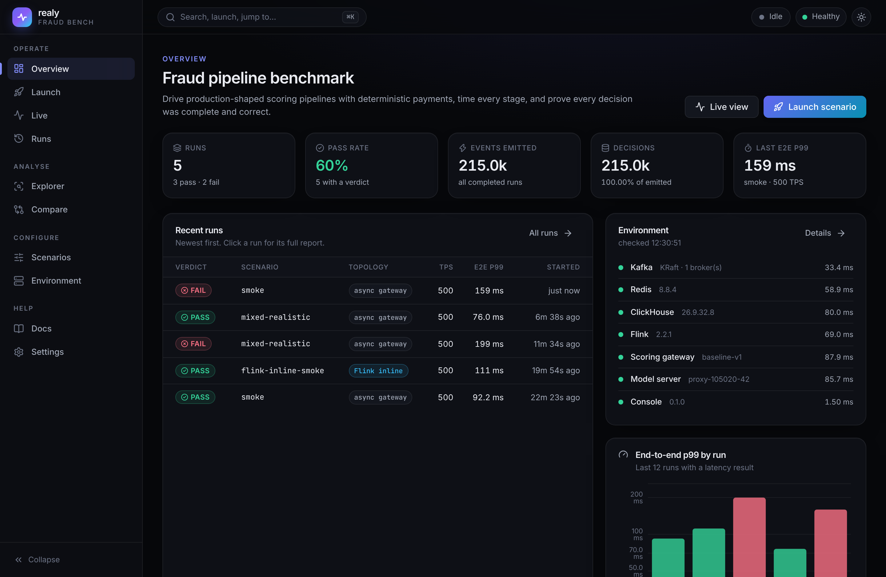
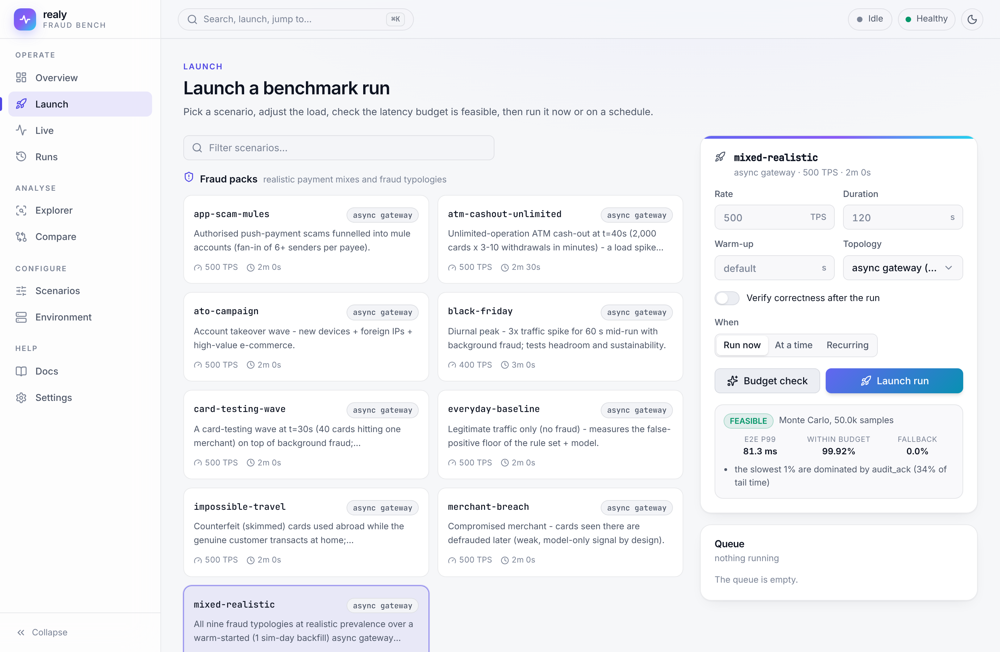
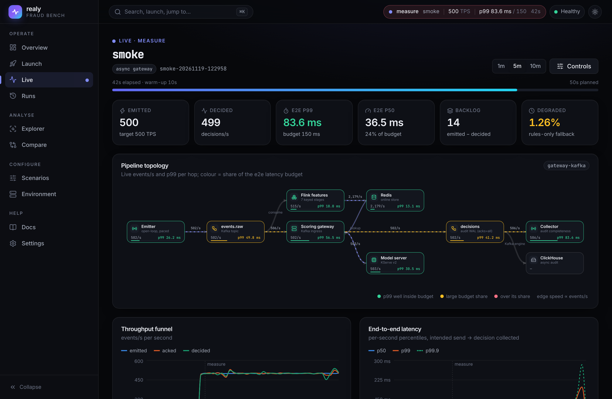
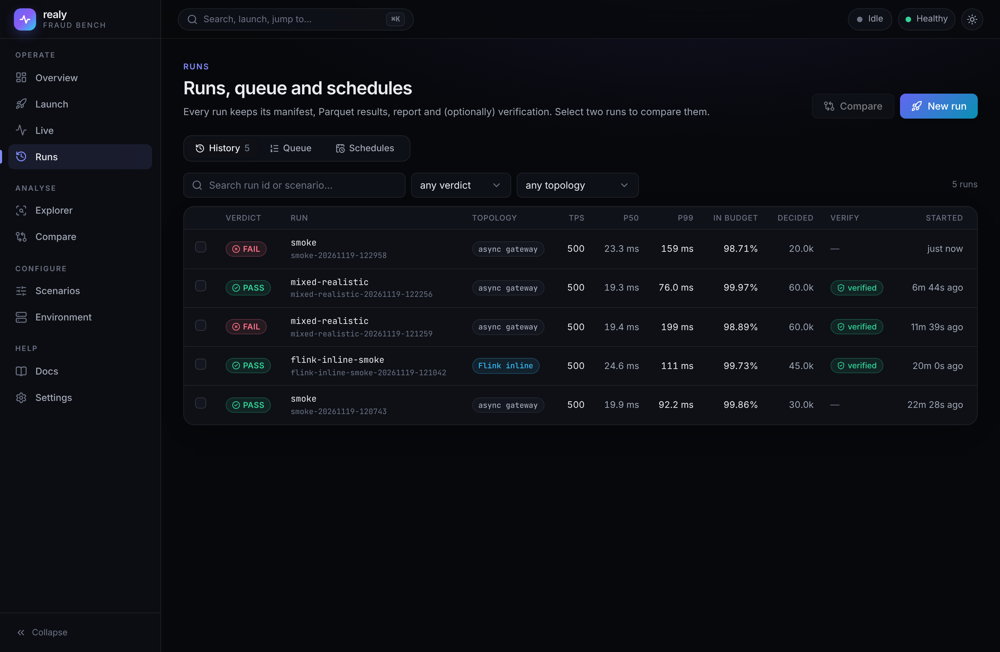
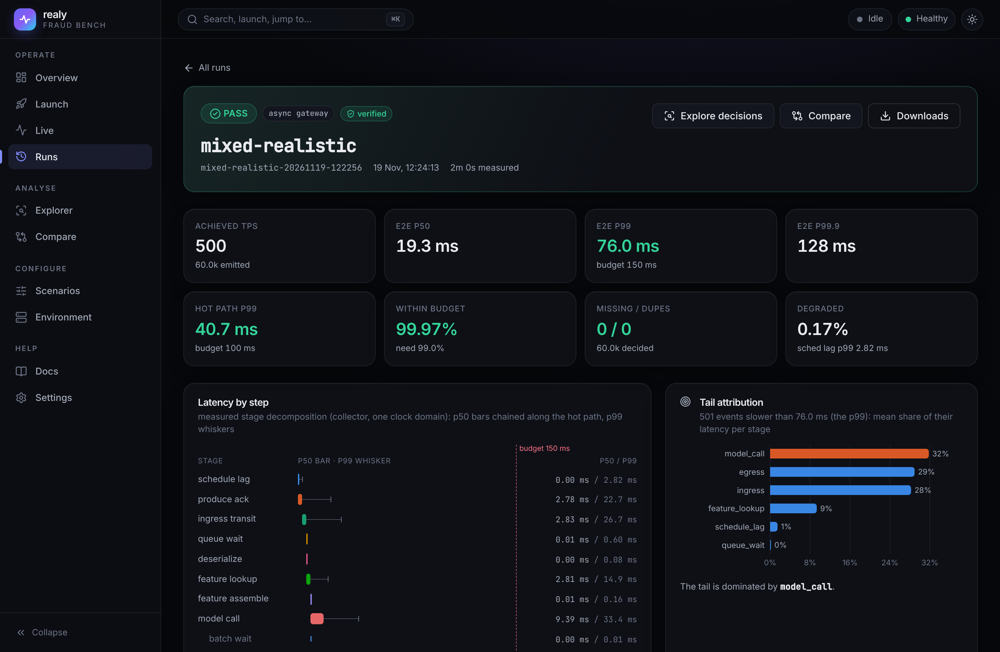
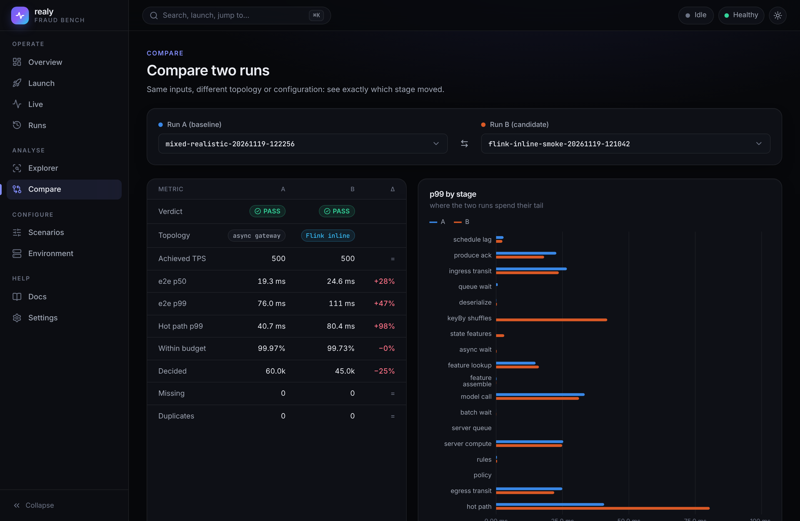
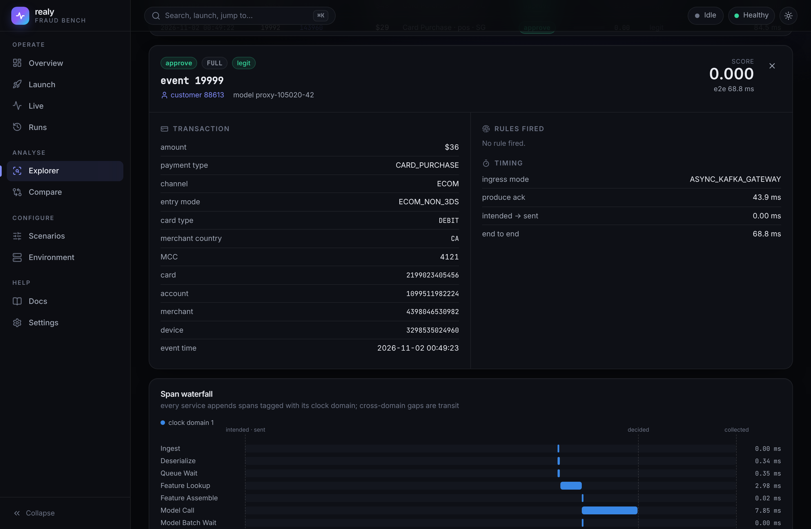
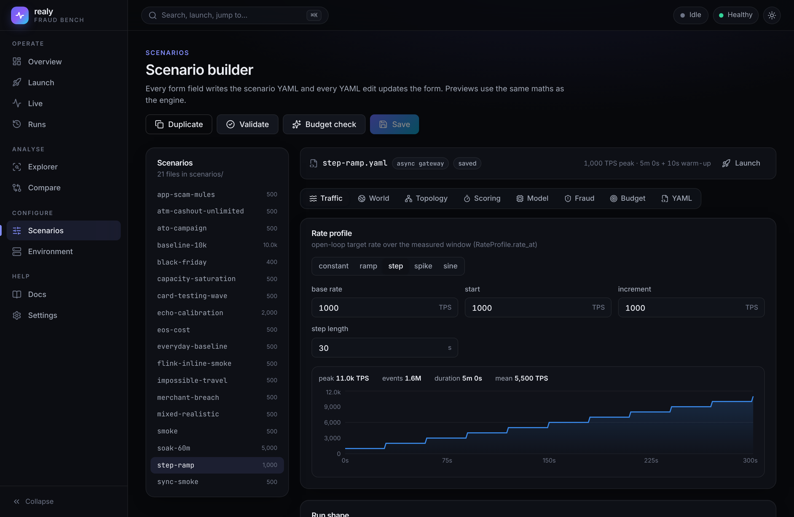
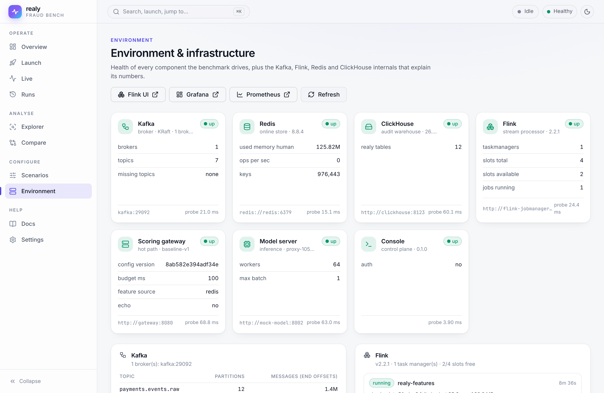
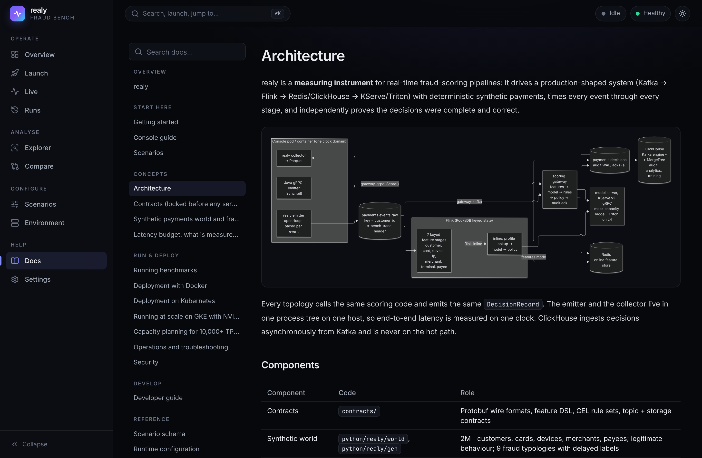

# Console guide

The console (http://localhost:8090, or the `console` Service on Kubernetes) is the operator's
cockpit. You launch and schedule runs, watch them live, steer them, read and compare reports,
inspect individual decisions, build scenarios, and check the health of every component. It is a
client of the [HTTP API](reference/http-api.md), so anything it does can be scripted.

* **Navigation:** the sidebar groups pages into *Operate*, *Analyse*, *Configure* and *Help*.
* **Top bar:** shows the current run's phase, TPS and p99 against the budget, plus an environment
  health dot.
* **Command palette:** press <kbd>⌘K</kbd> / <kbd>Ctrl K</kbd> to launch a scenario, jump to a run
  or page, or open a doc.
* **Themes:** dark by default, light in Settings. Layouts work down to phone width.

## Overview

The landing page.
* **Current run:** a live card while a run executes.
* **Totals:** runs, pass rate, events and decisions.
* **End-to-end p99 by run:** the last 12 runs against their budget.
* **Recent runs:** verdict badges; click one for its report.
* **Environment:** a component summary. A red dot means a dependency is down. See
  [Environment](#environment).

## Launch

1. **Pick a scenario.** Cards are grouped into fraud packs and performance packs and are
   searchable. Each shows topology, load and duration.
2. **Adjust the run** without editing the scenario:
   * TPS and duration;
   * topology (with a diagram of each);
   * backfill days, Flink state (warm or fresh), and verify after the run.
3. **Budget feasibility** updates inline. It runs a Monte Carlo of the configured latency
   distributions against the p99 budget, so an infeasible configuration (100 ms feature build +
   30-100 ms model vs 150 ms) is flagged *before* you spend a run on it.
4. **When:** *Run now*, *At a time* (once), or *Recurring* (every N minutes, optionally N times).
   Runs execute one at a time; **Queue** shows what is waiting.

## Live

Everything about the run in progress, refreshed every second over a WebSocket:

| Panel | Shows |
|---|---|
| KPI strip | emitted/s, decided/s, e2e p50 and p99 vs budget, backlog, degraded share, schedule lag (is the emitter on time?) |
| Pipeline topology | the actual topology of this run (emitter → Kafka → Flink stages → Redis → gateway → model → decisions → ClickHouse), with events/s and p99 on every node and hop. Colour is the share of the e2e budget each hop consumes. It adapts to every topology in `contracts/topologies.yaml` (gateway-kafka, gateway-grpc, flink-inline, echo-kafka, external) |
| Throughput funnel | emitted → acked → decided per second; a widening gap is backlog |
| End-to-end latency | p50 / p99 / p99.9 with the budget band, for the last 1, 5 or 10 minutes |
| Per-stage p99 | stacked per-stage latency: which stage is eating the tail |
| Backlog, schedule lag | is the pipeline keeping up, and is the instrument? |
| Decision feed | a sample of real decisions as they are made: outcome, score, amount, payment type, rules fired, path (model vs fallback). Click one to open it in Explorer |
| Live control | change the target rate, model service time and capacity, injected feature delay and deadline policy *during* the run. Changes go out on `bench.control` and are recorded in the run log |
| Run log | the driver's log: phases, Flink job switches, guardrail aborts |

**Abort** (in the control drawer) stops the run cleanly: the runner drains, writes a partial report
and marks the run aborted.

**Any run in progress, whoever started it.** A run started from the CLI, `make live-test`, a
Kubernetes Job or another console gets the same Live view: the console describes it from the pipeline
lease and its run directory (manifest, heartbeat, scenario) and streams its log from the runner's
`run.log`. A note says where it came from; Abort reaches it wherever it runs.

**Preparing vs running.** Before traffic starts, the bar under the title shows the active startup step
and its progress ("preparing for 6 min · step 9/13: feature catch-up · ETA 4 min"); warm-up and
measurement are timed from the start of traffic, not from the launch, so a large world's minutes of
history replay never read as an overrunning run.

**Replay a past run.** Pick any finished run in the run selector (or open `/live?run=<id>&t=<seconds>`,
also linked from the report). The page renders that run's recorded telemetry with the same panels: the
topology, every chart, the decision feed, the startup steps as they stood at that moment and the run
log. A scrubber plays it at 1×, 10× or 60×, and jumps to its phases (backfill, warm-up, measure,
drain), rate changes and aborts. Runs only keep one run per pipeline at a time (two load generators on
one pipeline would measure each other), so replay is how runs are compared moment by moment.

**Overlay the previous run.** "Overlay previous" draws the last run of the same scenario as dashed
series on the throughput and latency charts, aligned on the start of traffic: a regression is visible
while the run is still going, before the report's gate.

## Runs

Run history with filters (scenario, topology, verdict) and search, the queue, and schedules. Select
two runs to **compare** them. Every run keeps its manifest, Parquet results, report and, when
requested, its verification. Nothing is overwritten.

## Run report

| Section | Answers |
|---|---|
| Verdict | PASS/FAIL, with every failed condition as a reason (budget, compliance, loss, sustainability, abort) |
| KPIs | achieved TPS, e2e and hot-path p50/p99/p99.9, within-budget share, degraded share, loss and duplicates |
| Latency by step | a waterfall of the measured stage decomposition, in one clock domain |
| Latency over the run / vs offered load | p99 per window, and latency vs TPS with the knee marked (step and ramp profiles) |
| Throughput funnel | emitted → acked → decided |
| Tail attribution | which stages the slowest 1% of events spent their time in |
| Detection | per-typology recall, precision and false-positive rate against ground truth; per-rule precision |
| Verification | when run: Java↔Python feature agreement per entity, CEL rule parity, score/outcome recomputation |
| ClickHouse audit | completeness, duplicate collapse, visibility lag, replay |

**Downloads**: the HTML report, plus `report.json`, `verify.json` and `manifest.json` (the exact config the run used).

## Compare

Two runs side by side: KPIs with deltas, p99 by stage (where the tails differ) and overlaid latency
curves. The typical use is the same scenario and seed on two topologies or configurations, such as
`smoke` vs `sync-vs-async` vs `flink-inline-smoke`.

## Explorer

Look up any event, entity or campaign of a run, for every use case: card present, online payments,
transfers and APP scams, ATM cash-out, account takeover and the rest. What each view shows is data
(`contracts/explorer.yaml`), so a new entity column, context column or lens needs no UI code.

**Search.** By id (a bare number is tried as every kind of id and says which it matched), or with
kinds: `customer:`, `card:`, `account:`, `device:`, `ip:` (dotted or numeric), `merchant:`,
`terminal:`, `payee:`, `campaign:`, `event:`, `type:TRANSFER`, `channel:ECOM,IN_APP`, `entry:`,
`fraud:account_takeover` (or `any` / `none`), `outcome:DECLINE,CHALLENGE`, `rule:MULE_FAN_IN`,
`path:RULES_ONLY_FALLBACK`, `country:`, `ipcountry:`, `role:`, `label:fraud`. Terms are ANDed and
commas mean OR: `channel:ECOM fraud:account_takeover outcome:APPROVE` finds the takeovers that got
through online.

**Lenses.** One click sets the search, the entity list and its filter for a use case: Card present,
Online payments (devices shared by many cards), Transfers & APP scams (payees paid by many senders:
the mule shape), ATM cash-out (terminals), Account takeover, Shared devices, Merchants (ranked by
common point of purchase), Stopped payments, and one per typology of the run.

**Entities.** Customers, cards, accounts, devices, IPs, merchants, terminals and payees, each with
events, how many customers / cards / devices stand behind it, fraud, flagged, declined, stepped up,
max score and amount. Filters: with fraud, genuine + fraud, shared, flagged, and for merchants and
terminals **common point**: the cards used there (history included) that later saw fraud elsewhere,
ranked by lift over the base rate. In fraud-eval the top merchant is the breached one: 6 of its 11
cards later had merchant-breach fraud, 52× the base rate.

**An entity's trail.** Every event of the entity in time order: amount, payment type, truth (and when
it was reported), score (a rules-only fallback shows "rules only", never 0; genuine customers' tiny
probabilities keep their magnitude, e.g. `3e-5`), outcome with the step-up's fate, rules fired, the
entity's own state features as they built up, and **what it saw**: the columns that matter for that
kind of payment (a transfer: payee, new payee, transfers in 1 h, sent in 24 h, the payee's senders; an
online card payment: device, IP and its country, 3DS, CVV / AVS, scheme score; card present: entry
mode, PIN, cryptogram, terminal; ATM: terminal, ATM count and sum). A feature that was defaulted
because the payment lacks the entity shows "n/a", never a fake 0. Every id links to that entity's
trail (customer → their device → everyone on that device). Click a row to open the decision in place:
policy branch, the rules that fired with the values they saw, score and model version, the step-up's
fate and every feature. Above the trail: the world profile (a customer's cards, devices and regular
payees; a card's owner; a device outside the customer registry), totals including fraud $ paid and
good customers stopped, and the most frequent related entities. Long trails page.

**A decision** opens with the transaction (authorisation signals included: 3DS, PIN, cryptogram, CVV
/ AVS, scheme score; every id a link), the 62 features it was scored on grouped by entity with n/a
for defaulted ones, the decision (outcome, score or why there is none, model version, path, rules,
reason codes, revisions), the label story, the explanation (policy path, rules with values, model
attribution) and the span waterfall.

**Campaigns** lists the run's fraud campaigns with how far each got: stepped up, declined, stopped,
fraud paid out before the first stop, and $ paid (approved plus passed step-ups and reviews that do
not hold the payment). Selecting one shows its events with each one's role, marks the genuine story
events (a victim's own payments) and where the campaign was stopped.

## Scenarios

A visual builder kept in two-way sync with the scenario YAML: Traffic, World, Topology, Scoring,
Model, Fraud, Budget and YAML tabs. The previews (rate profile over time, latency-distribution
percentiles and CDF) use the same maths as the engine. **Validate**, **Budget feasibility**,
**Save** and **Duplicate** work on the current document. Saved scenarios are stored in the console's
scenario directory and appear on Launch. See [scenarios.md](scenarios.md) for every option.

## Environment

Health of every component the benchmark drives, plus the internals that explain its numbers:

* **Component cards:** Kafka, Redis, ClickHouse, Flink, gateway, model and console, each with
  status, version and probe latency.
* **Kafka:** topics with end offsets, and consumer-group lag for the gateway, Flink, ClickHouse and
  collectors.
* **Flink:** task managers and free slots, jobs and their state, per-vertex backpressure, and
  checkpoints (completed, failed, last duration and size).
* **Redis:** version, keys, memory, ops/s, clients and uptime.
* **ClickHouse:** rows, parts and bytes per table.
* **Links:** the Flink UI, Grafana and Prometheus (set `FLINK_UI_URL`, `GRAFANA_URL`,
  `PROMETHEUS_URL`).

## Docs

This documentation, rendered from the repository's `docs/` folder with search, Mermaid diagrams,
copyable code blocks and the generated references. It is the same Markdown GitHub shows.

## Settings and sign-in

* **Appearance:** dark or light theme, stored in this browser.
* **Session:** whether token login is enabled (`REALY_CONSOLE_TOKEN`), and sign-out.
* **Endpoints:** where the console sends its requests.

When a token is configured, every page first shows **Sign in**. See [security.md](security.md).
