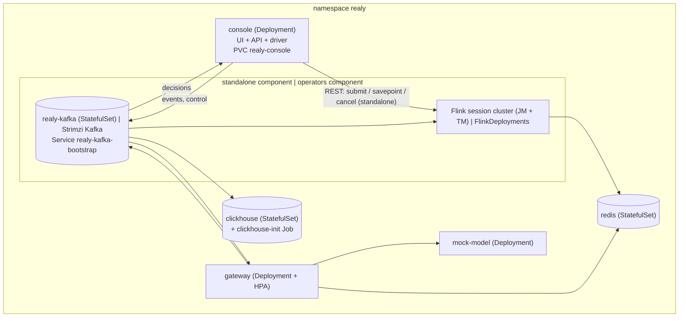

# Deployment on Kubernetes

The manifests in `deploy/k8s` are plain Kustomize, built from one base and opt-in components:

```
deploy/k8s/
  base/                     redis, clickhouse (+ schema Job), mock-model, gateway (+ HPA/PDB), console (+ PVC)
  components/
    standalone/             Kafka StatefulSet + topic Job, Flink session cluster - no operators, no CRDs
    operators/              Strimzi Kafka + KafkaTopics, FlinkDeployments, PodMonitors
    bench-job/              optional headless `realy run` Job
    console-ingress/        optional Ingress for the console
  overlays/
    local/                  base + standalone, small requests, NodePorts  -> k3d / kind / minikube / Docker Desktop
    dev/                    base + operators + bench-job, small           -> any cluster with the operators
    gke-l4/                 base + operators + bench-job + KServe Triton  -> production-shaped GKE with L4 GPUs
  local-up.sh               build -> cluster -> import -> apply -> wait   (make k8s-local)
```

Kafka is always reachable as `realy-kafka-bootstrap:9092`. That is Strimzi's Service name, and the
standalone StatefulSet copies it, so the base is the same for every target.



## Local cluster in one command

Requirements: Docker plus [k3d](https://k3d.io) (recommended) or [kind](https://kind.sigs.k8s.io).
`kubectl` is optional: the script falls back to the kubectl inside the k3s/kind node container. The
node needs about 4 CPUs and 10 GB.

```bash
make k8s-local          # = deploy/k8s/local-up.sh
open http://localhost:8090
```

`local-up.sh` does the following:
1. Builds the four images with Docker, exactly as `make up` does. Behind a proxy, set
   `REALY_BUILD_CA` and `HTTPS_PROXY` and it adds the compose proxy override.
2. Creates a k3d cluster `realy`, mapping host 8090 to the console's NodePort 30090 and 8081 to the
   Flink UI's 30081, with traefik and metrics-server disabled. It reuses the cluster if one exists.
3. Imports the images with `k3d image import`, so no registry is involved. Pods use
   `imagePullPolicy: IfNotPresent`.
4. Runs `kubectl apply -k deploy/k8s/overlays/local`.
5. Waits for the Kafka broker, the `kafka-topics` Job, ClickHouse and its `clickhouse-init` schema
   Job, and then every Deployment.

| Variable | Default | |
|---|---|---|
| `REALY_K8S` | `auto` | `k3d`, `kind`, or `current` (use the current kubectl context; images must be pullable). k3d pulls its helper images (`k3d-proxy`, `k3d-tools`) from ghcr.io; if your network blocks ghcr.io, use `kind`, whose node image comes from Docker Hub |
| `REALY_CLUSTER` | `realy` | cluster name |
| `REALY_K8S_PORT` / `REALY_K8S_FLINK_PORT` | `8090` / `8081` | host ports; change them when the compose stack is also running |
| `SKIP_BUILD` | | `1` = reuse images already in the Docker daemon |

Tear down with `deploy/k8s/local-up.sh down`. Run the CLI in the cluster with
`kubectl -n realy exec -it deploy/console -- realy run smoke`.

In the local overlay the console drives the Flink session cluster over REST, the same way the compose
stack does. Fresh and warm state, savepoint-based topology switches and `realy verify` all behave
identically. Checkpoints sit on one RWO volume shared by the JobManager and TaskManager. That works
on single-node clusters; on multi-node clusters, point `execution.checkpointing.dir` at object storage.

## Clusters with operators (dev, gke-l4)

Install the operators first:
* [Strimzi](https://strimzi.io) 0.45 or later;
* the [Flink Kubernetes Operator](https://nightlies.apache.org/flink/flink-kubernetes-operator-docs-stable/) 1.10 or later;
* optionally kube-prometheus-stack for the PodMonitors;
* for gke-l4, KServe in RawDeployment mode.

Then:

```bash
kubectl apply -k deploy/k8s/overlays/dev
kubectl -n realy get kafka,kafkatopic,flinkdeployment,pods
kubectl -n realy port-forward svc/console 8090
```

* **Flink jobs:** with the operators component the jobs are `FlinkDeployment`s in application mode.
  `realy-features` runs permanently, and `realy-inline` stays suspended until set to `running`. The
  console runs with `FLINK_REST=""`, so it observes the jobs and does not submit them.
* **Switching to flink-inline:** patch the FlinkDeployment `spec.job.state`. The operator's
  savepoint upgrade mode keeps the RocksDB state.
* **Images:** the FlinkDeployments use the same `realy/flink` image as the session cluster
  (`jarURI: local:///opt/flink/lib/realy/realy-flink-job.jar`, parent-first).

For production-shaped GKE with Triton on L4 GPUs, follow [k8s-l4.md](k8s-l4.md):
* node pools;
* pushing the images to a registry (`images:` in `overlays/gke-l4`);
* model repository upload;
* `REPLACE_BUCKET` for checkpoints.

## Console on Kubernetes

| Concern | How |
|---|---|
| State | PVC `realy-console`, with subPaths `runs` and `data`. The Deployment has one replica (`Recreate`), since it owns the run queue |
| Token | optional Secret `realy-console` (key `token`), see [security.md](security.md) |
| Ingress | add `../../components/console-ingress` to an overlay and patch host, class and TLS |
| Headless runs | the `bench-job` component, `kubectl -n realy create job --from=job/bench-run my-run`; reports land on the same PVC and appear in the console |
| Sizing | base: 8 CPU / 16 GiB (guaranteed QoS, so the driver never throttles while timing others); local: 0.5 to 4 CPU |

## Validating manifests

```bash
make k8s-validate    # kustomize build + kubeconform (strict, CRD catalog) for local, dev and gke-l4
python -m realy.k8s  # regenerate contract-derived ConfigMaps / KafkaTopics after changing contracts/
```

The generated files are `base/generated/*` (ClickHouse DDL, the proto format schemas),
`components/operators/generated/kafka-topics.yaml` and
`components/standalone/generated/kafka-topics-script.yaml`. CI fails if they drift from `contracts/`.
