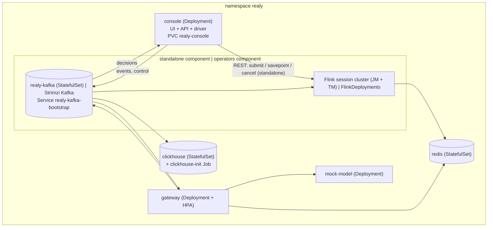

# Deployment on Kubernetes

The manifests in `deploy/k8s` are plain Kustomize, built from one base and opt-in components:

```
deploy/k8s/
  base/                     redis, clickhouse (+ schema Job, config), mock-model, gateway (+ HPA/PDB), console (+ PVC)
  components/
    standalone/             KRaft Kafka StatefulSet + topic Job, Flink session cluster - no operators, no CRDs
    kafka-3-brokers/        turns standalone Kafka into a 3-broker quorum: RF 3, min ISR 2, PDB
    local-sizing/           laptop requests, NodePorts, images never pulled, gateway pinned to 1 replica
    operators/              Strimzi Kafka + KafkaTopics, FlinkDeployments, PodMonitors
    bench-job/              optional headless `realy run` Job
    console-ingress/        optional Ingress for the console
  overlays/
    local/                  base + standalone + kafka-3-brokers + local-sizing -> kind / k3d / minikube / Docker Desktop
    local-1broker/          the same with one broker (RF 1) for smaller machines
    dev/                    base + operators + bench-job, small           -> any cluster with the operators
    gke-l4/                 base + operators + bench-job + KServe Triton  -> production-shaped GKE with L4 GPUs
  local-up.sh               build -> cluster -> load images -> apply -> wait   (make k8s-local)
  test.sh                   in-cluster acceptance test                        (make k8s-test)
  lib.sh                    provider + kubectl detection shared by both scripts
```

Kafka is always reachable as `realy-kafka-bootstrap:9092`. That is Strimzi's Service name, and the
standalone StatefulSet copies it, so the base is the same for every target.



## Local cluster: Kafka and Flink in the same cluster

```bash
make k8s-local          # build images, create a kind cluster, deploy everything, wait until Ready
make k8s-test           # prove it: platform checks, smoke, flink-inline + verify, broker failover
open http://localhost:8090
```

**Requirements.**
* Docker, plus one of [kind](https://kind.sigs.k8s.io) (default), [k3d](https://k3d.io) or
  [minikube](https://minikube.sigs.k8s.io). You can also use an existing context such as Docker
  Desktop's cluster (`REALY_K8S=current`).
* `kubectl` is optional: without it the scripts use the kubectl inside the kind / k3d node.

| Overlay | Kafka | Requests | Give the node (Docker Desktop / VM) |
|---|---|---|---|
| `local` (default) | 3 brokers, RF 3, min ISR 2 | ~3.5 CPU / 11 GiB | **6+ vCPU, 12+ GiB** |
| `local-1broker` (`REALY_KAFKA_BROKERS=1`) | 1 broker, RF 1 | ~3 CPU / 9 GiB | 4+ vCPU, 10+ GiB |

The latency budget needs CPU headroom beyond the requests. Three brokers replicating every write,
plus Flink, the gateway, ClickHouse and the driver on one node, saturate 4 vCPUs. On such a node
`make k8s-test` still proves correctness (zero loss, exact verification, failover), but the latency
rows fail. That is a statement about the node, not the pipeline. See [Measured here](#measured-here).

`local-up.sh` does the following:
1. **Build** the four images with Docker, exactly as `make up` does. Behind a proxy, set
   `REALY_BUILD_CA` and `HTTPS_PROXY` and it adds the compose proxy override.
2. **Cluster:** create or reuse the kind cluster `realy`. Host 8090 maps to the console's NodePort
   30090, and 8081 to the Flink UI's 30081. k3d and minikube work the same way.
3. **Load** the images (`kind load` / `k3d image import` / `minikube image load`). No registry is
   used; pods have `imagePullPolicy: IfNotPresent`.
4. **Preflight:** compare the node's allocatable CPU and memory with the overlay's requests, and warn
   if pods would stay Pending.
5. **Apply** `overlays/local` (or `local-1broker`).
6. **Wait** for the Kafka quorum, the `kafka-topics` Job, ClickHouse and its `clickhouse-init`
   schema Job, then every workload.

| Variable | Default | |
|---|---|---|
| `REALY_KAFKA_BROKERS` | `3` | `1` selects `overlays/local-1broker` |
| `REALY_K8S` | `auto` | `kind`, `k3d`, `minikube` or `current`; auto picks the first one installed in that order. k3d pulls helper images from ghcr.io; kind's node image comes from Docker Hub |
| `REALY_CLUSTER` | `realy` | cluster / profile name |
| `REALY_K8S_PORT` / `REALY_K8S_FLINK_PORT` | `8090` / `8081` | host ports; change them when the compose stack also runs |
| `REALY_MINIKUBE_CPUS` / `REALY_MINIKUBE_MEMORY` | `6` / `12g` | size of a new minikube profile |
| `SKIP_BUILD` | | `1` = reuse images already in the Docker daemon |

Tear down with `make k8s-down`. To use the CLI in the cluster:
`kubectl -n realy exec -it deploy/console -- realy run smoke`.

### How Kafka and Flink run in the cluster

* **Kafka:** the stock `apache/kafka` image as a KRaft StatefulSet, where every pod is broker and
  controller.
  * `kafka-start.sh` (a ConfigMap) derives each pod's node id, advertised listener and the controller
    quorum from the StatefulSet ordinal. The advertised listener is
    `realy-kafka-N.realy-kafka-headless.<ns>.svc.cluster.local:9092`.
  * Pods start in parallel, because a KRaft quorum needs a majority up before any broker is ready.
  * Clients bootstrap through the `realy-kafka-bootstrap` Service, Strimzi's name, so nothing else
    differs between standalone and operators.
  * With 3 brokers, topics are created at RF 3 with `min.insync.replicas=2`, and producers use
    `acks=all`. Every write is on two brokers before it is acknowledged, so losing any one broker
    loses nothing.
* **Flink:** a session cluster (JobManager + TaskManager Deployments) on the `realy/flink` image.
  * The console submits, savepoints, restores and cancels the realy jobs over REST, exactly as in
    compose. Fresh and warm state, savepoint-based topology switches and `realy verify` all behave
    identically.
  * Checkpoints sit on one RWO volume. Required pod affinity keeps the TaskManager on the
    JobManager's node, and likewise `bench-run` with the console. On multi-node clusters, point
    `execution.checkpointing.dir` at object storage instead.
* **Cold start:** the first run after deploying primes the pipeline with 30 s of unmeasured traffic
  ([operations.md](operations.md)), so its numbers are steady-state numbers.

### What `make k8s-test` proves

| Check | Passes when |
|---|---|
| pods Ready, init Jobs complete | every workload Ready; topics and the ClickHouse schema created |
| Kafka brokers, topic replication | all brokers Ready; `payments.events.raw` at RF = brokers (min ISR 2 with 3) |
| console `/api/env` | all 7 components report `up` from inside the cluster |
| smoke: zero loss / latency budget | every event decided (async gateway + Flink features); p99 within budget |
| flink-inline: zero loss / latency budget | the same, with Flink doing everything |
| verify | features recomputed independently match exactly, rule / score / outcome parity, ClickHouse audit complete |
| failover: zero loss | a 90 s smoke run in which `realy-kafka-1` is deleted at t≈40 s decides every event (3 brokers only) |
| failover: broker rejoined | the pod comes back and no partition is under-replicated |

Reports land in `./runs-k8s/`, and the exit code is non-zero if any check failed. The test is
at-least-once aware: a consumer-group coordinator move can replay a few uncommitted events. Those
are reported as duplicates, de-duplicated by event id in the collector and collapsed by ClickHouse;
only missing decisions fail the check.

### Measured here

This development sandbox cannot run Kubernetes itself (nested containers fail), so the manifests were
proven in three other ways.
1. **Schema:** kubeconform strict on every overlay, with byte-identical output from `kubectl kustomize`.
2. **Same broker config in Docker:** three `apache/kafka` containers running the **same** env and
   `kafka-start.sh` as the rendered manifest, with Docker network aliases standing in for the
   headless-Service DNS names.
3. **`test.sh` itself:** run end to end through a kubectl shim against those containers.

Results on a 4 vCPU host:

| Run | Correctness | Latency |
|---|---|---|
| KRaft quorum | 3 voters on per-pod FQDNs, leader elected; topics RF 3 / min ISR 2, full ISR | n/a |
| smoke, 3 brokers | 30,000 / 30,000 decided, 0 missing, 0 duplicates | FAIL: e2e p99 223-325 ms; host 4-14 % idle (CPU-saturated) |
| flink-inline-smoke + verify, 3 brokers | 0 missing; verify PASS (features exact, parity 100 %, ClickHouse 45,010 / 45,010) | FAIL: p99 185-287 ms (same CPU limit) |
| broker stopped mid-run and restarted, 3 brokers | 45,010 / 45,010 decided, 0 missing, 0 duplicates; ISR full again ~5 s after restart | spikes during leader moves |
| smoke, 1 broker (compose) | 0 missing | PASS: p99 87 ms |

A live `make k8s-local && make k8s-test` on a real kind / k3d cluster has not been run from this
sandbox. Run it on a machine with 6+ vCPUs and send the output if anything fails.

## Clusters with operators (dev, gke-l4)

Install the operators first:
* [Strimzi](https://strimzi.io) 0.45 or later;
* the [Flink Kubernetes Operator](https://nightlies.apache.org/flink/flink-kubernetes-operator-docs-stable/) 1.10 or later;
* optionally kube-prometheus-stack for the PodMonitors;
* for gke-l4, KServe in RawDeployment mode.

Then:

```bash
kubectl apply -k deploy/k8s/overlays/dev
kubectl -n realy get kafka,kafkatopic,flinkdeployment,pods
kubectl -n realy port-forward svc/console 8090
```

* **Flink jobs:** with the operators component the jobs are `FlinkDeployment`s in application mode.
  `realy-features` runs permanently, and `realy-inline` stays suspended until set to `running`. The
  console runs with `FLINK_REST=""`, so it observes the jobs and does not submit them.
* **Switching to flink-inline:** patch the FlinkDeployment `spec.job.state`. The operator's
  savepoint upgrade mode keeps the RocksDB state.
* **Images:** the FlinkDeployments use the same `realy/flink` image as the session cluster
  (`jarURI: local:///opt/flink/lib/realy/realy-flink-job.jar`, parent-first).

For production-shaped GKE with Triton on L4 GPUs, follow [k8s-l4.md](k8s-l4.md):
* node pools;
* pushing the images to a registry (`images:` in `overlays/gke-l4`);
* model repository upload;
* `REPLACE_BUCKET` for checkpoints.

## Console on Kubernetes

| Concern | How |
|---|---|
| State | PVC `realy-console`, with subPaths `runs` and `data`. The Deployment has one replica (`Recreate`), since it owns the run queue |
| Token | optional Secret `realy-console` (key `token`), see [security.md](security.md) |
| Ingress | add `../../components/console-ingress` to an overlay and patch host, class and TLS |
| Headless runs | the `bench-job` component, `kubectl -n realy create job --from=job/bench-run my-run`; reports land on the same PVC and appear in the console |
| Sizing | base: 8 CPU / 16 GiB (guaranteed QoS, so the driver never throttles while timing others); local: 0.5 to 4 CPU |
| Gateway replicas | the local overlays pin the HPA to 1 replica: an autoscaler resizing the gateway mid-run causes consumer-group rebalances that show up as latency |

## Validating manifests

```bash
make k8s-validate    # kustomize build + kubeconform (strict, CRD catalog) for local, local-1broker, dev, gke-l4
python -m realy.k8s  # regenerate contract-derived ConfigMaps / KafkaTopics after changing contracts/
```

The generated files are `base/generated/*` (ClickHouse DDL, the proto format schemas, the ClickHouse
config override shared with compose),
`components/operators/generated/kafka-topics.yaml` and
`components/standalone/generated/kafka-topics-script.yaml`. CI fails if they drift from `contracts/`.
