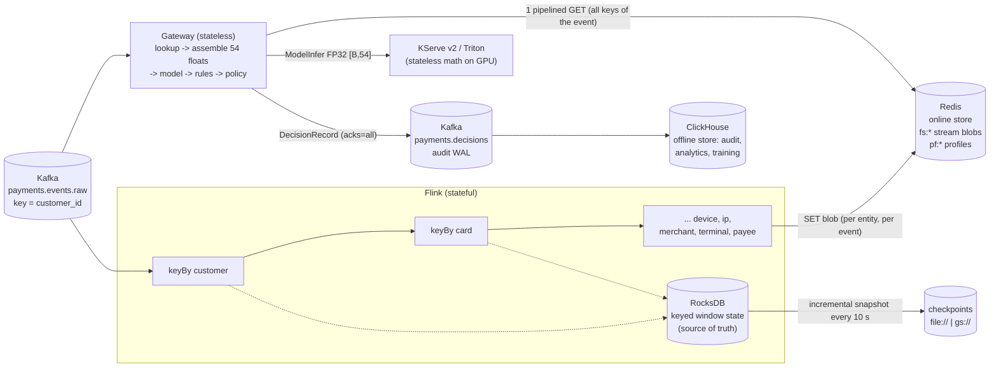

# Feature store, state and inference

This is how Kafka, Flink, RocksDB, Redis, ClickHouse and the model server (KServe / Triton) work
together to turn one payment into one decision. It follows a single real payment from a run, byte
by byte, then covers:
- what each store is for;
- how state survives failures;
- what changes at scale;
- the alternatives and why they were not chosen.

Related docs: [architecture.md](architecture.md) has every stage and option, and
[fraud-detection.md](fraud-detection.md) has the features, rules and typologies. The byte-level
store layout is in [contracts/storage/redis.md](../contracts/storage/redis.md).

## The short version



| Component | Owns | Writes | Reads | Never does |
|---|---|---|---|---|
| **Kafka** | the ordered, replayable log of events, decisions and labels | emitter / gateway mirror (events), gateway and Flink (decisions) | Flink, gateway, ClickHouse, collectors | compute anything |
| **Flink** | streaming aggregates: per-entity windows over every event | RocksDB (its own key groups), Redis `fs:*` | Kafka events | score, or read Redis (in `features` mode) |
| **RocksDB** | Flink's keyed state, the exact window contents per entity | Flink operator, locally | the same operator, locally | serve anyone else |
| **Redis** | a low-latency serving copy of the latest per-entity aggregates + static profiles | Flink (`fs:*`), the profile seeder (`pf:*`) | the gateway (one pipelined round trip per event) | compute, or be the system of record |
| **Gateway** | the decision: deadlines, tensor assembly, rules, policy, audit | Kafka decisions | Kafka events (async) or gRPC/HTTP (sync), Redis | keep state between events |
| **KServe / Triton** | model math (MLP / GBDT) on CPU or GPU | nothing | the tensor in the request | look anything up |
| **ClickHouse** | the offline store: every decision with the exact features it was scored on, labels, history | Kafka engine → materialized views | analysts, `pulsebench verify`, `pulsebench train`, Grafana | sit on the hot path |

The split exists because **each store answers a different question at a different speed**:
- **RocksDB:** "what exactly happened to this card in the last 10 minutes" (local, exact, durable through checkpoints).
- **Redis:** "give me the current aggregates of these 7 entities in under a millisecond" (remote, shared, disposable).
- **ClickHouse:** "what did we know and decide about every payment, ever, and was it right" (columnar, append-only, minutes of lag are fine).

## One payment, end to end

Every number below is from one event of a 500 TPS `smoke` run on the async gateway topology
(`gateway-kafka`), Flink in `features` mode, on one 4 vCPU host. It is a legitimate hotel booking
that the rules sent to review.

### 1. The event on Kafka

The emitter produces it to `payments.events.raw` at its intended time.
- **Key:** `customer_id` as a decimal string, `"97327"`. Every event of this customer lands in the
  same partition, in order.
- **Headers:** `x-bench-trace` (intended and sent time, clock domain) and `x-run-id`.
- **Value:** a `TransactionEvent` protobuf:

```json
{"event_id": 15134, "payment_type": "CARD_PURCHASE", "customer_id": 97327, "card_id": 2199023420233,
 "amount_minor": 30278, "currency": "USD", "amount_usd_minor": 30278, "merchant_id": 4398046527732,
 "mcc": 7011, "merchant_country": "US", "channel": "ECOM", "entry_mode": "CREDENTIAL_ON_FILE",
 "card_present": false, "device_id": 3298535038959, "ip_v4": 194810807, "ip_country": "US", "ip_asn": 7922}
```

Ground truth (known to the generator, never sent to the pipeline): `is_fraud = false`. MCC 7011 is
hotels.

### 2. Flink: seven keyed stages, RocksDB and the Redis write

The Flink job (`features` mode) reads the same record and passes it through one keyed stage per
entity, in schema order: customer → card → device → ip → merchant → terminal → payee. `keyBy` routes the
event to the subtask that owns that entity's key group (a network shuffle each time). There,
`EntityFeatureFunction` does three things:
1. **Reads** the entity's window state, one RocksDB `ValueState<byte[]>`: sparse time buckets per
   window, plus the distinct/novel key sets and last-event fields.
2. **Updates it with this event, then reads the features** ("update, then read"), and writes the
   state back to RocksDB.
3. **Writes the entity's blob to Redis:** `SET fs:<entity>:<id>` with an 8-day TTL. The write is
   fire-and-forget: the operator never waits for Redis.

After this event, the customer's blob, decoded with `pulsebench store get customer 97327`, has this
shape (output from a live run; values differ per customer):

```text
fs:customer:99443  411 B  schema v1  STATE blob: last event 415941, state 339 B  written 246.3 s ago  TTL 690954 s
  cust_count_1h                            1.0000
  cust_count_24h                           3.0000
  cust_amount_sum_24h                   9725.0000     <- USD minor units (cents)
  cust_amount_avg_30d                    417.5000
  cust_device_novel                        0.0000
  ...
pf:customer:99443  48 B  schema v1
  cust_tenure_days                       265.0000
  cust_segment                             0.0000
  cust_avg_ticket_usd                     13.4543
  home_lat / home_lon / home_country_idx / tz_offset_min   (profile attributes: inputs to derived features)
```

- **State blobs (customer and card):** they carry the window state itself, so the gateway can
  re-window it at the time of the event it is scoring. These blobs are 0.3 to 1.5 KB.
- **Values blobs (the other five entities):** they hold only the values as of the entity's last
  event, at 60 to 90 B.
- **Byte layout:** see [redis.md](../contracts/storage/redis.md).

### 3. Gateway: lookup and tensor assembly

The gateway's Kafka consumer picks the event up 31.1 ms after its intended time. That covers the
emitter's produce, the broker write and the gateway's poll; on this loaded host most of it was
queueing. Then the gateway:
1. **Evaluates the CEL filters once** (`purchase`, `cnp_small`, ...) into a bitmask that every
   feature reuses.
2. **Looks up the event's keys in one pipelined round trip** (`GET`s). The keys are the stream blobs of
   the entities the event has, plus the two profiles: here `fs:customer:97327`, `fs:card:…`,
   `fs:device:…`, `fs:ip:…`, `fs:merchant:…`, `pf:customer:97327` and `pf:merchant:…`. There is no
   terminal (card-not-present) and no payee (not a transfer).
   - **Measured:** 2.46 ms, inside a 30 ms feature deadline.
   - **On deadline:** the decision falls back to rules only.
3. **Assembles the 54-float vector in schema order** (`FeatureAssembler`), 0.03 ms:
   - **State blobs:** re-windowed at this event's time and the event applied, the same code Flink
     runs. Customer and card features are therefore exact, not "as of the last event".
   - **Values blobs:** used as stored. With `self_inclusion` the current event's own contribution
     is added to counts and sums, because Flink's write for this event cannot have happened yet.
   - **Profiles:** `cust_tenure_days`, `cust_avg_ticket_usd`, merchant risk.
   - **Derived features**, computed now: `amount_usd = 302.78`, `is_cnp = 1`,
     `amount_to_avg_ratio = 6.57` (302.78 / 46.07), `dist_from_home_km = 0`, `local_hour = 18.0`.
   - **Missing bitmap:** marks features whose key was absent or timed out. They are served with the
     feature's declared default.

The vector, with zero-valued features omitted:

```json
{"cust_count_1h": 1, "cust_count_24h": 3, "cust_amount_sum_24h": 32125, "cust_amount_avg_30d": 10708.3,
 "cust_distinct_countries_24h": 1, "cust_device_novel": 1, "cust_ip_country_novel": 1,
 "card_count_1m": 1, "card_count_5m": 1, "card_count_1h": 1, "card_count_24h": 3,
 "card_amount_sum_1h": 30278, "card_amount_sum_24h": 32125, "card_amount_max_7d": 30278,
 "card_distinct_merchants_10m": 1, "card_distinct_merchants_24h": 3, "card_secs_since_last": 6264.4,
 "dev_count_5m": 1, "dev_distinct_cards_1h": 1, "dev_distinct_customers_24h": 1,
 "ip_count_5m": 1, "ip_distinct_cards_1h": 1,
 "cust_tenure_days": 4021, "cust_segment": 2, "cust_avg_ticket_usd": 46.07, "merch_risk_tier": 2,
 "merch_fraud_rate_30d": 0.003, "amount_usd": 302.78, "is_cnp": 1, "amount_to_avg_ratio": 6.57,
 "local_hour": 18.0}
```

Read as an analyst would:
- the customer has a 4,021-day tenure;
- they are paying from a device they have never used before, from an IP country new to them;
- the amount is 6.6× their usual ticket, at a medium-risk merchant;
- there is no velocity: one transaction on the card this hour.

### 4. Inference: KServe v2 `ModelInfer`

The gateway, not the model server, built the tensor. The model server receives numbers only:

```text
ModelInferRequest {
  model_name: "fraud_mlp"
  inputs:  [{ name: "input__0", datatype: "FP32", shape: [1, 54] }]      # [B, 54]; B > 1 when micro-batched
  outputs: [{ name: "output__0" }]
  raw_input_contents: [ 216 bytes = 54 little-endian float32 ]           # MODEL_INPUT_DIM pads to the production width
}
-> ModelInferResponse { model_version: "proxy-105020-42", raw_output_contents: [ float32 score ] }
   parameters: queue_us, compute_us, batch_size      (mock and Triton report server-side time)
```

- **Score:** `0.0000116`. The model is confident this is legitimate, and it is.
- **Call time:** 4.50 ms in total, of which 3.09 ms is server compute.
- **Same contract everywhere:** the mock model server and Triton on L4 speak the same KServe v2
  gRPC. Only `MODEL_TARGET` changes.

### 5. Rules, policy and the decision

- **Rules:** the CEL rules run on the same named features (0.02 ms). Two fire:
  `ATO_NEW_DEVICE_HIGH_AMOUNT` (REVIEW) and `ATO_NEW_DEVICE_NEW_COUNTRY` (REVIEW in `baseline-v2`).
- **Policy:** the precedence is DECLINE rule > ALLOW rule > score ≥ 0.90 > REVIEW rule > score ≥ 0.55
  > APPROVE. Here no DECLINE or ALLOW rule fired and the score is far below the decline threshold, so
  a REVIEW rule decides: **REVIEW**.
- **Why it matters:** under `baseline-v1` the second rule was a DECLINE, and this good customer would
  have been declined. That rule's measured precision was 0.047; see
  [fraud-detection.md](fraud-detection.md#rules).

The gateway writes the `DecisionRecord` (outcome, score, rule hits, reason codes, model version,
the full feature vector, per-entity freshness and the trace) to `payments.decisions`:
- **Durability:** `acks=all`, idempotent producer.
- **Commit point:** the Kafka source offset is committed only once that write is acknowledged
  (commit-lowest-pending). A crash can therefore duplicate a decision but never lose one.

Hot path for this event, from ingest to decision: **12.5 ms**:
- queue wait 4.2 ms;
- feature lookup 2.5 ms;
- model 4.5 ms;
- rules + policy 0.02 ms;
- the remainder in the async hand-offs.

End to end, from intended time to the collector seeing the decision, it took **56.3 ms**.

### 6. ClickHouse: the offline store

ClickHouse consumes `payments.decisions` through a Kafka engine table and a materialized view.
Nothing on the hot path waits for it. The row in `realy.decisions` holds:
- **Features:** the exact vector as served, `features_raw` plus 54 typed `f_*` columns.
- **Rules:** the rule hits (`rule_ids`, `rule_actions`).
- **Freshness:** per entity looked up, the age of its stored values at scoring time (`fresh_entity`,
  `fresh_age_us`, `fresh_found`).
- **Audit timing:** the broker's append time (`appended_at`, LogAppendTime) and
  `lat_audit_append_us`, the time from decision to durable append.
- **Latency:** the per-stage columns.

Days later the label arrives on `payments.labels` (`realy.labels`):
- **Fraud:** a chargeback, customer report or investigation.
- **Legitimate:** none, ever.
- **Friendly fraud:** a chargeback on a legitimate purchase.

`v_training_dataset` joins the two. Because the features are the ones logged at decision time, the
training set is **point-in-time correct by construction**:
- no feature is recomputed later with knowledge of the future;
- there is no train/serve skew.

`label_time` / `label_delay_s` say when each label became known, which is what training with
`--labels observed` cuts on.

```sql
SELECT rule_id, fires, precision FROM realy.v_rule_performance WHERE run_id = '…' ORDER BY fires DESC;
SELECT quantileExact(0.99)(lat_audit_append_us) / 1e3 AS audit_append_p99_ms FROM realy.decisions WHERE run_id = '…';
SELECT f_amount_to_avg_ratio, label_is_fraud, label_delay_s FROM realy.v_training_dataset WHERE run_id = '…';
```

## Online vs offline feature store

| | Online (Redis) | Offline (ClickHouse) |
|---|---|---|
| Question | current aggregates of these entities, now | what was known at decision time, for every decision |
| Latency | ~0.2–3 ms per event (one pipelined round trip) | seconds to minutes of ingest lag; queries over billions of rows |
| Contents | latest blob per entity (overwritten) | every served vector, decision, label (append-only, `ReplacingMergeTree`) |
| Written by | Flink, continuously | Kafka engine, asynchronously |
| Used for | scoring | training, audit, analytics, verification, monitoring |
| Retention | 8-day TTL (refreshed on write) | 400 days (decisions) |

Training never reads Redis, and scoring never reads ClickHouse. The bridge is the served-feature
logging: whatever the model saw is what it is trained on. Feast and similar feature stores solve the
same problem by materializing offline features into the online store. Here the direction is
reversed: online first, logged offline.

## State: RocksDB vs Redis

Both hold per-entity aggregates, but they are not interchangeable.

| | RocksDB (Flink keyed state) | Redis (online store) |
|---|---|---|
| Role | **source of truth** for streaming aggregates | **serving copy** for a stateless scorer |
| Contents | full window state per entity (buckets, distinct sets, last event) | latest values (+ state for customer/card) per entity |
| Writer / reader | the owning Flink subtask, locally (embedded, no network) | written by Flink, read by any gateway replica over the network |
| Consistency | exact per key: events are processed in Kafka partition order and the state is snapshotted together with the source offsets | last-writer-wins blobs, no transactions; lags Flink by `store_update_lag` |
| Durability | checkpoints: incremental snapshots every 10 s to durable storage; restored on failure | none in these deployments (`--save "" --appendonly no`): disposable, rebuilt from the stream |
| Capacity | disk: TBs per job, spread over key groups | RAM: `maxmemory` 3 GB (compose) / 24 GB (GKE), `allkeys-lru` |
| Access latency | microseconds (local block cache / SSD) | sub-millisecond network round trip, pipelined |
| Expiry | state TTL 8 days (`OnCreateAndWrite`, cleaned in RocksDB compaction) | key TTL 8 days, refreshed on every write |
| Scales by | Flink parallelism (key groups move between subtasks on rescale) | Redis Cluster shards (hash slots) |

**Why not only Redis**, with the gateway doing read-modify-write of aggregates?
- **Lost updates:** concurrent gateway replicas would race on read-modify-write for every shared
  entity (merchant, device, IP), and windows would be updated with no ordering guarantee.
- **No consistent recovery:** there would be no snapshot tied to the stream position, so after a crash
  nobody knows which events are already counted.
- **Slower hot path:** every event would cost writes on the scoring path.

**Why not only RocksDB**, scoring inside Flink?
- **That is the `flink-inline` topology,** which exists and is measured: its features are exact.
- **Tail latency:** the seven `keyBy` shuffles sit on the decision path. Measured: 42% of the p99
  tail.
- **No synchronous answer:** Flink cannot answer a synchronous card authorisation (there is no
  request/response).
- **Scaling and restarts are coupled:** scorer and state scale together, and a restart or rescale
  stalls decisions.

**Why both:** Flink computes exactly and durably, off the hot path; Redis serves those results to a
stateless, horizontally scaled scorer in one round trip. Recovering Redis needs nothing more than
time and the stream.

## Checkpoints, savepoints and recovery

**Checkpoint configuration** (`FraudJob.configure`, compose / Kubernetes Flink config):
- **Schedule:** every 10 s, at least 5 s apart, with a 120 s timeout.
- **Storage:** RocksDB with **incremental** checkpoints, so only changed SST files are uploaded.
  The location is `file:///checkpoints` locally; in production, object storage (`gs://…`).
- **Default mode, `AT_LEAST_ONCE`:** checkpoint barriers are not aligned, so a checkpoint never
  stalls the stream and adds no tail latency.
  - **On recovery:** up to one checkpoint interval of events is reprocessed.
  - **Effect on state:** RocksDB is restored to the snapshot, so it ends up exact again.
  - **Effect on outputs:** the reprocessed events re-emit decisions (inline mode) and Redis writes.
    Downstream handles those as duplicates: the collector and ClickHouse dedupe on
    `(run_id, event_id, revision)`, and Redis blobs simply converge to the newest value.
- **`EXACTLY_ONCE` (`exactly_once: true`, the `eos-cost` scenario):**
  - **How:** unaligned checkpoints plus a transactional Kafka sink, and read-committed consumers
    downstream.
  - **Guarantee:** no duplicates, ever.
  - **Cost:** a decision becomes visible only when the checkpoint that contains it commits.
    Measured: e2e p50 5.3 s, p99 10.2 s against 61 ms of hot path.
  - **Use:** fine for an audit stream, never for authorisation.
- **Source offsets:** offsets are committed back to Kafka on checkpoint
  (`commit.offsets.on.checkpoint`). Kafka's consumer-lag view of `realy-flink` therefore trails by up
  to one checkpoint. On restore, Flink uses the offsets stored in the checkpoint, not Kafka's.
- **Stable operator uids** (`source`, `features-<entity>`, `scoring`, `decisions-sink`) let state be
  re-attached across code changes.
  - **Mode switches:** `features` ↔ `inline`/`both` happen by **stop-with-savepoint** and
    resubmitting from it, so RocksDB state stays warm across topology changes.
  - **On savepoint failure:** the driver cancels the job and logs that state starts cold.

### What happens when something fails

| Failure | What survives | What the pipeline does | What a run shows |
|---|---|---|---|
| **Flink TaskManager dies** | last checkpoint (state + offsets) | job restarts, restores RocksDB, rewinds the source to the checkpointed offsets and reprocesses ≤ 10 s of events | gateway keeps scoring from Redis (features up to the outage old); `store_update_lag` spikes, then recovers; zero decisions lost (live-test fault: `flink taskmanager restart`) |
| **Redis restarts** (no persistence) | nothing in Redis; RocksDB and the profiles source are intact | `fs:*` blobs reappear as Flink processes each entity's next event; profiles are re-seeded at the next run; meanwhile the gateway sees "no blob" | features of entities not yet rewritten fall back to first-event values (counts restart, novelty = 1) → a burst of reviews; the pipeline lease (also in Redis) is re-acquired by the running run's heartbeat; zero decisions lost (live-test fault: `redis restart`) |
| **Kafka broker restarts** | the log (replicated: RF 3 / min ISR 2 on the 3-broker cluster) | producers retry idempotently, consumers rebalance and resume from committed offsets | a latency spike, zero loss (live-test fault: `kafka broker restart`; Kubernetes: broker failover with ISR recovery) |
| **Gateway restarts** | committed offsets (lowest pending) | the new instance resumes after the last decision that was acknowledged by the audit WAL | possible duplicates (at-least-once), zero loss (live-test fault: `gateway restart`) |
| **Model server slow / down** | n/a | per-call deadline → rules-only fallback (degraded, flagged), or provisional-then-final, by `on_deadline` | `degraded_fraction`, `rules_only_fallback` in the report |

Measured outcomes of these faults are in [operations.md](operations.md#resilience-measured).

**Rebuilding Redis without waiting for traffic:**
- **Replay:** rewind the Flink job to an older savepoint, or replay Kafka (events are retained 6 h
  here; set retention to your longest cold-start tolerance) into a temporary job with `--write-store`.
- **Bulk export:** use Flink's State Processor API to read a savepoint and write every entity's blob.
- **In production:** add an AOF or a Redis replica so a restart is not a cold start at all. The
  `allkeys-lru` policy keeps Redis serving under memory pressure by evicting the least recently used
  entities, which then behave like the restart case above.

## How it scales

Measured per event on this build: 9 Redis GETs at most (7 stream + 2 profile keys, one round
trip), up to 7 Redis SETs from Flink, a 54-float tensor (216 B), and a decision record of about
1.5 KB. At the 20k TPS peak of the production plan ([production.md](production.md)):

| Tier | Load at 20k TPS | Scales by |
|---|---|---|
| Kafka `events.raw` | 20k msgs/s, ~6–8 MB/s | partitions (48): the ceiling on gateway consumers and Flink source parallelism |
| Flink | 7 keyed stages × 20k = 140k state reads+writes/s, 7 shuffles/event | parallelism (key groups); RocksDB state grows with active entities × window buckets |
| Redis | ≤ 180k GET/s in 20k pipelines/s + ≤ 140k SET/s; state blobs make customer/card reads 0.3–1.5 KB | Redis Cluster shards; pipelines are split per hash slot by the client |
| Gateway | 20k decisions/s, stateless | replicas (HPA) up to the partition count |
| Model | 20k rows/s, micro-batched client-side and dynamically batched by Triton | GPU instances / replicas; batch size trades latency for throughput |
| ClickHouse | 20k rows/s of ~1.5 KB, asynchronous | Kafka engine consumers, shards; never on the hot path |

`pulsebench size` turns measured per-event costs into node counts, and `pulsebench store get` shows what one
entity costs in Redis.

## Alternatives considered

| Option | Pros | Cons | Verdict |
|---|---|---|---|
| **Gateway assembles the tensor, model server is pure math** (this design) | one round trip to Redis; the model server stays stateless and swappable (mock ↔ Triton); features, rules and model share one vector; served vector logged for training | the gateway must know the feature schema (generated from the same DSL) | chosen |
| **KServe transformer + feature store (Feast-style)** | standard KServe pattern; data scientists own pre-processing | an extra hop per request (gateway → transformer → predictor); Python transformers add ms at p99; rules need the same features, so they are fetched twice or the rules move too | good for model-owned features; adds latency here |
| **Features inside the model server** (custom backend reads Redis) | one hop fewer | couples GPU servers to the store; GPU nodes wait on network I/O; harder to scale and to test | rejected |
| **Score inside Flink** (`flink-inline`) | exact features with no store; one system | shuffles on the decision path (42% of the p99 tail measured); no synchronous answer; restarts stall decisions | kept as a topology for exactness and async use cases |
| **Redis-only aggregates** (gateway read-modify-write) | no Flink | lost updates on shared entities, no consistent recovery, writes on the hot path | rejected |
