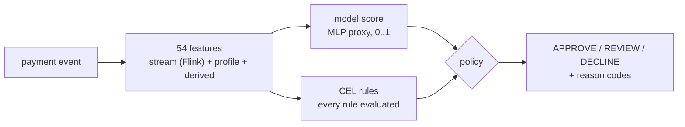

# Fraud detection: features, rules, model, typologies and honest evaluation

This page explains how a payment is judged fraudulent and why each signal exists. It covers what
the nine synthetic fraud typologies look like and how well the system catches each one, measured on
a world the model has never seen. For the plumbing (how features get from Flink to Redis to the
model), see [feature-store-and-inference.md](feature-store-and-inference.md).

## How a payment is judged



**Policy precedence** (`RuleSet.decide`, identical in Java and in the Python verifier):

| Order | Condition | Outcome |
|---|---|---|
| 1 | any DECLINE rule fired | DECLINE |
| 2 | any ALLOW rule fired | APPROVE |
| 3 | score ≥ decline threshold (0.90) | DECLINE |
| 4 | any REVIEW rule fired | REVIEW |
| 5 | score ≥ review threshold (0.55) | REVIEW |
| 6 | otherwise | APPROVE |

The model and the rules see exactly the same vector. The thresholds come from the rule set and can
be overridden live (`ScoringConfig.review_threshold` / `decline_threshold`).

**When the model misses its deadline,** the rules decide alone on the **rules-only fallback**
path: the score is ignored and the decision is flagged `degraded`. The report counts these
decisions separately, so a model's quality is never confused with its availability.

## Features

There are 54 features in `contracts/features/feature_schema.yaml`, which is also the model's tensor
order. Window semantics, identical in Flink, the gateway and the Python verifier:
- **Buckets:** windows are bucketed on event time. Bucket `k = floor(t / granularity)`, and a window
  of W covers the most recent `W / granularity` buckets.
- **Counts, sums, maxima, averages and distinct counts** include the current event ("update, then
  read").
- **Novelty, time-since-last and geo-speed** compare with *previous* events.

| Group | Features (window) | What it captures | Typologies it exposes |
|---|---|---|---|
| Customer velocity | `cust_count_1h`, `cust_count_24h`, `cust_amount_sum_24h`, `cust_transfer_count_1h`, `cust_transfer_sum_24h` | how busy the customer is vs normal | ATO, APP scam, bust-out |
| Customer habits | `cust_amount_avg_30d` (purchases), `cust_distinct_countries_24h` | the customer's normal ticket and geography | counterfeit, ATO |
| Customer novelty | `cust_device_novel` (90 d), `cust_payee_novel` (180 d), `cust_ip_country_novel` (90 d) | first time this device / payee / IP country is seen for the customer | ATO, APP scam |
| Card velocity | `card_count_1m/5m/1h/24h`, `card_amount_sum_1h/24h`, `card_amount_max_7d` | bursts on the card | card testing, lost/stolen, cash-outs |
| Card testing | `card_small_cnp_count_10m` (< $2 card-not-present), `card_distinct_merchants_10m/24h` | tiny online authorisations, merchant hopping | card testing, bots |
| Contactless | `card_contactless_count_30m`, `card_contactless_sum_30m` | many tap payments under the CVM limit | lost/stolen |
| ATM | `card_atm_count_1h`, `card_atm_sum_24h` | repeated withdrawals | ATM cash-out, counterfeit |
| Travel | `card_geo_speed_kmh` (card-present), `card_secs_since_last` | physically impossible journeys | counterfeit (cloned card abroad) |
| Device / IP | `dev_count_5m`, `dev_distinct_cards_1h`, `dev_distinct_customers_24h`, `ip_count_5m`, `ip_distinct_cards_1h` | one device or IP using many cards / people | bots, card testing, breach cash-out |
| Merchant / terminal | `merch_count_1m`, `merch_small_cnp_count_5m`, `merch_amount_sum_1h`, `term_count_5m`, `term_atm_sum_1h` | a merchant under attack, an ATM being emptied | card-testing waves, ATM cash-out |
| Payee | `payee_inbound_count_1h`, `payee_inbound_sum_24h`, `payee_distinct_senders_24h` | money flowing into one account from many senders | APP scams / mules |
| Profile (seeded) | `cust_tenure_days`, `cust_segment`, `cust_avg_ticket_usd`, `merch_risk_tier`, `merch_fraud_rate_30d` | slow-moving context | all (calibration) |
| Derived (at scoring) | `amount_usd`, `is_cnp`, `is_contactless`, `is_atm`, `is_transfer`, `is_foreign`, `dist_from_home_km`, `amount_to_avg_ratio`, `local_hour`, `credit_utilisation_24h` | the event itself relative to the customer | all |

Amounts in stream features are USD **minor** units (cents); `amount_usd` is dollars.

**Exactness by topology** (measured by `pulsebench verify`):

| Topology | Customer / card features | Shared entities (device, IP, merchant, terminal, payee) |
|---|---|---|
| `flink-inline` | exact (computed in the scoring task) | arrival order across partitions, as in production |
| `gateway-*`, state blobs (default) | 99.7% exact-set agreement; the rest is store lag | as of the entity's last Flink write |
| `gateway-*`, values blobs | 82.6% (windows not re-anchored to the event's time) | the same |

## Rules

Rule set `baseline-v2` (`rules/baseline.yaml`, CEL). Every rule is evaluated for every event and
recorded (`rule_ids`), so precision is measurable per rule. The precision column is measured on the
out-of-sample evaluation run (fraud-eval, seed 1337).

«RULE_TABLE»

**What changed from `baseline-v1`, and how it was decided:**
- **`ATO_NEW_DEVICE_NEW_COUNTRY`: DECLINE → REVIEW.**
  - **Why:** on a seed-42 run, a world other than the evaluation's, `pulsebench rules-whatif` measured
    precision 0.047 over 1,876 fires.
  - **Effect as REVIEW:** 3.68% → 0.82% of good customers declined, with flagged recall unchanged.
  - **Rejected alternative:** a DECLINE split on `amount_to_avg_ratio ≥ 8 / 12` added under 1 point
    of decline recall, at precision 0.077.
  - **On the evaluation world:** see below.
- **`VELOCITY_CARD_1H_DISTINCT` renamed `VELOCITY_CARD_10M_DISTINCT`:** it always used the 10-minute
  window.

«RULE_CHANGE_EVAL»

## The model

- **Architecture:** a structural proxy, `StandardScaler` → MLP (64, 32), plus an XGBoost GBDT for
  Triton FIL. It runs as ONNX on Triton, or as weights JSON on the mock model server.
- **Training data** (`pulsebench train`): the **served** feature vectors of a training run. There is no
  recomputation, and therefore no train/serve skew.
- **Labels:** `--labels observed` (the default) uses what the bank knows 30 days after the last
  event:
  - **What counts as fraud:** a fraud label (chargeback, customer report or investigation) that was
    published and arrived within the maturity window.
  - **Never reported (10% of campaigns):** trains as legitimate.
  - **Friendly-fraud chargebacks on legitimate purchases:** train as fraud.
  - **Ground truth:** `--labels ground-truth` uses the generator's truth, an upper bound no
    institution has.
- **Provenance:** each trained model records the world hash, seed and scenario of its training runs
  (`models/proxy/versions/<version>.training.json`).
- **Leakage guard:** every report checks the served model against that provenance and prints
  **in-sample** (a warning: optimistic numbers), **out-of-sample** or **unknown**.
- **Redeploying:** `pulsebench deploy-model <weights>` hot-swaps the weights in the mock model server
  through `ModelServerConfig.weights_path`. With Triton, publish to the model repository instead.

## Labels: late, partial and noisy

| Typology | Label source | Delay (× 1–45 days) | Notes |
|---|---|---|---|
| card testing | chargeback | 1.0 | |
| account takeover | customer report | 1.0 | |
| lost / stolen | customer report | 0.3 | victims notice quickly |
| counterfeit | customer report | 0.5 | |
| merchant breach | chargeback | 1.0 | |
| ATM cash-out | investigation | 0.2 | bank-detected |
| APP scam (mule) | customer report | 0.3 | |
| bust-out | investigation | 1.5 | first-party fraud: found at charge-off |
| bot e-commerce | chargeback | 1.0 | |
| *friendly fraud* | chargeback | 1.0 | 0.2 per 1,000 legitimate remote purchases: a legitimate payment labelled fraud |

10% of campaigns are never reported at all. The decision is per campaign, as with a victim who
never notices.

«LABEL_STATS»

## Typologies

Each typology is scripted from real-world patterns (`python/realy/gen/campaigns.py`). It is
scheduled inside the measured window of `fraud-eval`, and measured there out of sample.

«TYPOLOGY_TABLE»

### Card testing
- **Real world:** stolen card numbers are validated with tiny online authorisations, often at one
  weak merchant, before the working cards are cashed out at high-risk resellers.
- **In the data:** 4–12 authorisations of $0.50–1.99 per card, seconds apart, card-not-present, from
  a fraud device and a hosting-provider IP. Working cards then make 1–3 purchases of $300–1,500.
  - **Wave mode:** 40 cards hitting one merchant within 5 minutes.
- **Lights up:** `card_small_cnp_count_10m`, `card_count_1m`, `merch_small_cnp_count_5m` (waves),
  `dev_distinct_cards_1h` / `ip_distinct_cards_1h`.
- **Rules:** `CARD_TESTING` (≥ 3 small CNP in 10 min → DECLINE) and `CARD_TESTING_MERCHANT`
  (merchant burst → REVIEW).
- **Model:** the cash-out purchases after testing, where small-amount rules no longer apply.

### Account takeover (ATO)
- **Real world:** credentials phished or stuffed, then used from the fraudster's device and network
  for resaleable goods, often followed by a transfer out.
- **In the data:** 1–4 purchases of $150–2,000 at high-risk online merchants, from a new device and
  an IP in a fraud-source country; half the campaigns end with a $500–5,000 transfer to a mule.
- **Lights up:** `cust_device_novel`, `cust_ip_country_novel`, `amount_to_avg_ratio` (7–150×
  measured), `dist_from_home_km`, `local_hour` (night in the customer's time zone), and
  `cust_payee_novel` on the transfer.
- **Rules:** `ATO_NEW_DEVICE_HIGH_AMOUNT` and `ATO_NEW_DEVICE_NEW_COUNTRY` (both REVIEW); the model
  carries the decline.
- **Why REVIEW, not DECLINE:** legitimate customers also change phones, travel and use mobile IPs.
  A new device plus a new IP country alone is weak evidence.

### Lost / stolen card
- **Real world:** a physical card is spent quickly, near where it was taken, contactless and just
  under the no-PIN (CVM) limit.
- **In the data:** 4–9 contactless POS payments at 92–99% of the local CVM limit, 1.5–3 minutes
  apart, in the victim's home city.
- **Lights up:** `card_contactless_count_30m`, `card_contactless_sum_30m`, `card_count_5m`.
- **Rules:** `CONTACTLESS_SPLIT` (≥ 4 contactless payments totalling > $200 in 30 min → REVIEW) and
  `VELOCITY_CARD_5M`.

### Counterfeit (skimmed / cloned card)
- **Real world:** a card skimmed at home is cloned onto magstripe and used abroad.
- **In the data:** a genuine chip transaction at home, then 2–6 magstripe POS purchases ($150–1,500)
  and 0–3 ATM withdrawals in a city more than 1,500 km away, in another country, 10–80 minutes later.
- **Lights up:** `card_geo_speed_kmh` (physically impossible), `is_foreign`, `dist_from_home_km`, the
  magstripe entry mode.
- **Rules:** `IMPOSSIBLE_TRAVEL` (DECLINE) and `MAGSTRIPE_FOREIGN` (REVIEW).

### Merchant breach
- **Real world:** card data stolen from a merchant is used weeks later by a common crew, online.
- **In the data:** 15 victims who shopped at the breached merchant. Hours to days later, each makes
  1–3 online purchases ($80–900) through three shared fraud devices and one IP.
- **Lights up:** `dev_distinct_cards_1h`, `dev_distinct_customers_24h`, `ip_distinct_cards_1h`,
  `cust_device_novel`.
- **Rules:** `BOT_DEVICE_MANY_CARDS` once the shared device has seen 4+ cards. Earlier events rely on
  the model.

### ATM cash-out (unlimited operation)
- **Real world:** a crew withdraws with hundreds of cloned cards at a few ATMs within minutes, usually
  in another country.
- **In the data:** 80–200 cards × 3–6 withdrawals of $300–500 at 8–20 ATMs in one city, within
  15 minutes. Cross-border with `foreign_prob` (fraud-eval runs one abroad and one at home).
- **Lights up:** `card_atm_count_1h`, `term_atm_sum_1h`, `is_foreign`, the magstripe entry mode.
- **Rules:** `ATM_VELOCITY` (DECLINE), `ATM_TERMINAL_CASHOUT` (REVIEW), `MAGSTRIPE_FOREIGN`.

### APP scam (authorised push payment) and mules
- **Real world:** victims are talked into sending money themselves. The payments look authorised (own
  device, own IP), but many victims pay one mule account.
- **In the data:** 8 victims, each sending one $1,000–9,000 transfer from their own device to the
  same mule payee within a few hours.
- **Lights up:** `payee_distinct_senders_24h` and `payee_inbound_sum_24h` (fan-in), plus
  `cust_payee_novel`, `is_transfer` and `amount_usd` for each victim.
- **Rules:** `MULE_FAN_IN` (6+ senders in 24 h → DECLINE) and `APP_SCAM_NEW_PAYEE` (REVIEW).
- **Limitation:** the first five victims, before the fan-in threshold, depend on the model.

### Bust-out (first-party fraud)
- **Real world:** a customer builds a good history, then maxes out the credit line with no intention
  to repay.
- **In the data:**
  - **Build-up:** 6–12 ordinary purchases at home near the customer's usual ticket, ramping up in
    frequency (3/4 of them in the second half). These are labelled **legitimate**, as they are in
    the real world.
  - **Bust:** 3–6 purchases splitting about 90–110% of the credit limit (electronics, jewellery,
    airlines, resellers).
- **Lights up:** `credit_utilisation_24h`, `amount_to_avg_ratio`, `card_amount_sum_24h`.
- **Rules:** `BUST_OUT_UTILISATION` (utilisation > 0.8 and 8× the usual ticket → REVIEW).
- **Why it is hard:** the build-up makes the account look healthy; only the bust is anomalous.

### Bot e-commerce attack
- **Real world:** scripted checkouts cycle many stolen cards through one merchant from one device.
- **In the data:** 10–12 cards × 1–2 purchases of $5–80 at one merchant, over 5–30 minutes, from one
  device and IP.
- **Lights up:** `dev_distinct_cards_1h`, `ip_distinct_cards_1h`, `merch_count_1m`.
- **Rules:** `BOT_DEVICE_MANY_CARDS` (DECLINE).

## Legitimate behaviour and false positives

The legitimate world is not uniform:
- customers have habits (favourite merchants, usual ticket sizes, time-of-day patterns);
- they travel (itineraries with flights, trips abroad and card use while away);
- they upgrade phones;
- they use mobile networks whose IPs move between countries;
- a few file friendly-fraud chargebacks.

That is where false positives come from, measured per rule as the `legit_hit_rate`:

«FP_TABLE»

## Training and evaluation

```bash
make eval                     # all of the below, in Docker (deploy/compose/eval.sh)
pulsebench run fraud-train         # seed 7: a world of its own
pulsebench train --run /runs/fraud-train-…            # observed labels (default) -> /models/proxy/versions/<v>.weights.json
pulsebench train --run /runs/fraud-train-… --labels ground-truth
pulsebench deploy-model /models/proxy/versions/<v>.weights.json
pulsebench run fraud-eval          # seed 1337: no customer, card, device, merchant or campaign in common
pulsebench rules-whatif /runs/fraud-eval-… --rules rules/baseline-v1.yaml
```

«EVAL_TABLE»

## Worked example: a card-testing burst, event by event

«WORKED_EXAMPLE»
