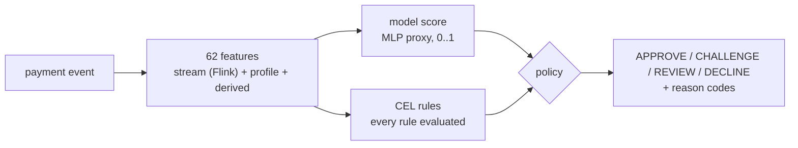

# Fraud detection: features, rules, model, typologies and honest evaluation

This page explains how a payment is judged fraudulent and why each signal exists. It covers what
the nine synthetic fraud typologies look like and how well the system catches each one, measured on
a world the model has never seen. For the plumbing (how features get from Flink to Redis to the
model), see [feature-store-and-inference.md](feature-store-and-inference.md). For what this
simulation leaves out of a real payment flow, see
[How close is this to a real payment flow?](#how-close-is-this-to-a-real-payment-flow)

## How a payment is judged



**Policy precedence** (`RuleSet.decide` in Java, `realy.policy` in Python; `pulsebench verify`
proves they agree on every decision):

| Order | Condition | Outcome |
|---|---|---|
| 1 | any DECLINE rule fired | DECLINE |
| 2 | any ALLOW rule fired | APPROVE |
| 3 | score ≥ decline threshold (0.90) | DECLINE |
| 4 | any CHALLENGE rule fired | CHALLENGE if the payment can be stepped up, else REVIEW |
| 5 | score ≥ challenge threshold (0.55), payment can be stepped up | CHALLENGE |
| 6 | any REVIEW rule fired | REVIEW |
| 7 | score ≥ review threshold (0.55) | REVIEW |
| 8 | otherwise | APPROVE |

The model and the rules see exactly the same vector. The thresholds come from the rule set and can
be overridden live (`ScoringConfig.review_threshold` / `challenge_threshold` / `decline_threshold`).
Rows 4–5 exist only in rule sets with step-up (`baseline-v4`); see [Step-up](#step-up-challenge).

**When the model misses its deadline,** the rules decide alone on the **rules-only fallback**
path: the score is ignored and the decision is flagged `degraded`. The report counts these
decisions separately, so a model's quality is never confused with its availability.

## Features

There are 62 features in `contracts/features/feature_schema.yaml` (schema v2), which is also the model's tensor
order. A derived feature is either a library function (`fn`) or a **CEL expression** (`expr`) over the
rules' environment, `event` and `f` (every feature computed so far). For example,
`{name: cvv_mismatch, source: derived, expr: "!event.cvv_match"}` adds a feature with no Java or Python
code: booleans become 1 / 0, Java and the verifier evaluate the same expression, and an invalid one
fails when the schema loads. Window semantics, identical in Flink, the gateway and the Python verifier:
- **Buckets:** windows are bucketed on event time. Bucket `k = floor(t / granularity)`, and a window
  of W covers the most recent `W / granularity` buckets.
- **Counts, sums, maxima, averages and distinct counts** include the current event ("update, then
  read").
- **Novelty, time-since-last and geo-speed** compare with *previous* events.

| Group | Features (window) | What it captures | Typologies it exposes |
|---|---|---|---|
| Customer velocity | `cust_count_1h`, `cust_count_24h`, `cust_amount_sum_24h`, `cust_transfer_count_1h`, `cust_transfer_sum_24h` | how busy the customer is vs normal | ATO, APP scam, bust-out |
| Customer habits | `cust_amount_avg_30d` (purchases), `cust_distinct_countries_24h` | the customer's normal ticket and geography | counterfeit, ATO |
| Customer novelty | `cust_device_novel` (90 d), `cust_payee_novel` (180 d), `cust_ip_country_novel` (90 d) | first time this device / payee / IP country is seen for the customer | ATO, APP scam |
| Card velocity | `card_count_1m/5m/1h/24h`, `card_amount_sum_1h/24h`, `card_amount_max_7d` | bursts on the card | card testing, lost/stolen, cash-outs |
| Card testing | `card_small_cnp_count_10m` (< $2 card-not-present), `card_distinct_merchants_10m/24h` | tiny online authorisations, merchant hopping | card testing, bots |
| Contactless | `card_contactless_count_30m`, `card_contactless_sum_30m` | many tap payments under the CVM limit | lost/stolen |
| ATM | `card_atm_count_1h`, `card_atm_sum_24h` | repeated withdrawals | ATM cash-out, counterfeit |
| Travel | `card_geo_speed_kmh` (card-present), `card_secs_since_last` | physically impossible journeys | counterfeit (cloned card abroad) |
| Device / IP | `dev_count_5m`, `dev_distinct_cards_1h`, `dev_distinct_customers_24h`, `ip_count_5m`, `ip_distinct_cards_1h` | one device or IP using many cards / people | bots, card testing, breach cash-out |
| Merchant / terminal | `merch_count_1m`, `merch_small_cnp_count_5m`, `merch_amount_sum_1h`, `term_count_5m`, `term_atm_sum_1h` | a merchant under attack, an ATM being emptied | card-testing waves, ATM cash-out |
| Payee | `payee_inbound_count_1h`, `payee_inbound_sum_24h`, `payee_distinct_senders_24h` | money flowing into one account from many senders | APP scams / mules |
| Profile (seeded) | `cust_tenure_days`, `cust_segment`, `cust_avg_ticket_usd`, `merch_risk_tier`, `merch_fraud_rate_30d` | slow-moving context | all (calibration) |
| Derived (at scoring) | `amount_usd`, `is_cnp`, `is_contactless`, `is_atm`, `is_transfer`, `is_foreign`, `dist_from_home_km`, `amount_to_avg_ratio`, `local_hour`, `credit_utilisation_24h` | the event itself relative to the customer | all |
| Authorisation signals (v2, CEL expressions) | `cvv_mismatch`, `avs_mismatch`, `three_ds_authenticated`, `pin_verified`, `cryptogram_missing`, `scheme_score` | what the authorisation request itself says: the CVV / address check, 3DS result, PIN, chip or token cryptogram, the card network's risk score | card testing, breach, bots (CVV, 3DS, score), counterfeit (no cryptogram), lost / stolen (no PIN) |
| CVV failures (v2, stream) | `card_cvv_fail_count_1h`, `merch_cvv_fail_count_5m` | repeated CVV failures on a card, or across one merchant (enumeration) | card testing, BIN attacks |

Amounts in stream features are USD **minor** units (cents); `amount_usd` is dollars.

**Authorisation signals** are fields of the payment event, as an issuer receives them with the
request (`three_ds`, `pin_verified`, `cryptogram_valid`, `scheme_score`, beside `cvv_match` /
`avs_match`).

How they are drawn (`python/realy/gen/auth.py`):
- **Rates are data:** each population's rates are scenario `fraud.auth` for genuine payments, and
  each typology's `auth` block for fraud (contracts/usecases).
- **Who passes:**
  - card testers and bots rarely pass 3DS and carry high network scores;
  - a lost or stolen card has a valid chip but no PIN;
  - a cloned stripe has no valid cryptogram;
  - an APP-scam victim's payment looks genuine.
- **Drawn per event,** from the event id and seed, after the events exist. No other random stream
  moves, so every pre-existing event keeps its values, and runs before and after stay comparable.

**Schema changes are append-only.** v2 appended eight features, so a v1 vector (54 values) is an
exact prefix of a v2 one:
- feature logs, ClickHouse `f_*` columns and the models of earlier runs keep their meaning;
- older vectors are widened with each new feature's default where needed;
- models bind their inputs by name (`ProxyModel.bind`, `ProxyScorer`), so a model trained on 54
  features scores 62-wide vectors exactly as before;
- warm state is reused only when the stream-feature layout matches (the provenance identity includes
  it), because the keyed state and the online-store blobs are laid out by it.

**Exactness by topology** (measured by `pulsebench verify`):

| Topology | Customer / card features | Shared entities (device, IP, merchant, terminal, payee) |
|---|---|---|
| `flink-inline` | exact (computed in the scoring task) | arrival order across partitions, as in production |
| `gateway-*`, state blobs (default) | 99.7% exact-set agreement; the rest is store lag | as of the entity's last Flink write |
| `gateway-*`, values blobs | 82.6% (windows not re-anchored to the event's time) | the same |

## Rules

Rule set `baseline-v4` (`rules/baseline.yaml`, CEL; `baseline-v1` / `-v2` / `-v3` kept for comparison:
v4 is v3 with step-up, see [Step-up](#step-up-challenge)). Every rule is evaluated for every event and
recorded (`rule_ids`), so precision is measurable per rule. Measured on the out-of-sample evaluation
run (fraud-eval, seed 1337, run under `baseline-v2`):

| Rule | Action | Fires | Precision | Legitimate customers hit | Fires when |
|---|---|---|---|---|---|
| `CARD_TESTING` | DECLINE | 369 | 1.000 | 0.00% | ≥ 3 small card-not-present authorisations on the card in 10 min |
| `VELOCITY_CARD_5M` | REVIEW | 111 | 1.000 | 0.00% | > 6 transactions on the card in 5 min |
| `CARD_TESTING_MERCHANT` | REVIEW | 163 | 1.000 | 0.00% | a merchant receiving a burst of small CNP authorisations |
| `MAGSTRIPE_FOREIGN` | REVIEW | 2,078 | 0.999 | 0.00% | magstripe fallback abroad (cloned card) |
| `SCORE_DECLINE` | DECLINE | 4,456 | 0.986 | 0.02% | model score ≥ 0.90 |
| `CONTACTLESS_SPLIT` | REVIEW | 89 | 0.978 | 0.00% | ≥ 4 contactless payments totalling > $200 in 30 min |
| `ATM_TERMINAL_CASHOUT` | REVIEW | 2,762 | 0.975 | 0.02% | terminal dispensed > $5,000 in 1 h |
| `ATM_VELOCITY` | DECLINE | 2,042 | 0.975 | 0.02% | ≥ 3 ATM withdrawals on the card in 1 h |
| `VELOCITY_CARD_10M_DISTINCT` | REVIEW | 33 | 0.970 | 0.00% | card at 5+ distinct merchants in 10 min |
| `BOT_DEVICE_MANY_CARDS` | DECLINE | 500 | 0.936 | 0.01% | device used with 4+ cards in 1 h |
| `MULE_FAN_IN` | DECLINE | 192 | 0.891 | 0.01% | payee paid by 6+ distinct senders in 24 h |
| `SCORE_REVIEW` | REVIEW | 400 | 0.812 | 0.03% | model score ≥ 0.55 |
| `BUST_OUT_UTILISATION` | REVIEW | 359 | 0.490 | 0.06% | credit line > 80% used in 24 h with an 8× ticket |
| `IMPOSSIBLE_TRAVEL` | DECLINE | 554 | 0.356 | 0.12% | card-present payments implying > 900 km/h |
| `APP_SCAM_NEW_PAYEE` | REVIEW | 2,432 | 0.104 | 0.74% | > $1,000 transfer to a payee never paid before |
| `ATO_NEW_DEVICE_HIGH_AMOUNT` | REVIEW | 2,553 | 0.098 | 0.78% | > $300 remote purchase from a device never seen for the customer |
| `ATO_NEW_DEVICE_NEW_COUNTRY` | REVIEW (removed in v3) | 9,618 | 0.036 | 3.15% | new device + new IP country + > $100 |

**What changed since `baseline-v1`, and how it was decided:**
- **`ATO_NEW_DEVICE_NEW_COUNTRY`: DECLINE → REVIEW.**
  - **Why:** on a seed-42 run, a world other than the evaluation's, `pulsebench rules-whatif` measured
    precision 0.047 over 1,876 fires.
  - **Effect as REVIEW:** 3.68% → 0.82% of good customers declined, with flagged recall unchanged.
  - **Rejected alternative:** a DECLINE split on `amount_to_avg_ratio ≥ 8 / 12` added under 1 point
    of decline recall, at precision 0.077.
  - **On the evaluation world:** see below.
- **`VELOCITY_CARD_1H_DISTINCT` renamed `VELOCITY_CARD_10M_DISTINCT`:** it always used the 10-minute
  window.
- **`baseline-v3`: `ATO_NEW_DEVICE_NEW_COUNTRY` removed.** Even as REVIEW it was the only
  reason for 52% of the legitimate customers sent to review or declined, at precision 0.036, while
  the model and `ATO_NEW_DEVICE_HIGH_AMOUNT` catch almost all the same fraud. Decided on fraud-train (seed 7):
  FPR 3.84% → 1.86%, flagged recall 0.944 → 0.943.

**The rule changes, replayed on the evaluation world** (`pulsebench rules-whatif`, fraud-eval served
vectors and scores, observed-label model):

| Rule set | Flagged recall | Declined recall | Precision (flagged / declined) | Good customers declined | Sent to review or declined (FPR) | Fraud $ approved |
|---|---|---|---|---|---|---|
| baseline-v1 (ATO country rule = DECLINE) | 0.919 | 0.880 | 0.306 / 0.344 | 3.32% | 4.13% | $213,891 |
| baseline-v2 (= REVIEW, as run) | 0.919 | 0.845 | 0.306 / 0.908 | 0.17% | 4.13% | $213,891 |
| **baseline-v3** (rule removed, current) | 0.915 | 0.845 | 0.503 / 0.908 | 0.17% | **1.79%** | $217,585 |
| v3b (also drop the two ~10%-precision REVIEW rules; rejected) | 0.886 | 0.845 | 0.862 / 0.908 | 0.17% | 0.28% | $449,093 |

- **v1 → v2:** 19× fewer good customers declined (3.32% → 0.17%), at 3.5 points of decline recall.
  Those payments still go to review.
- **v2 → v3:** the review queue is halved (4.13% → 1.79% of legitimate customers) for 0.3 points of
  flagged recall and $3.7k more fraud approved, out of $2.86M.
- **Method:** every variant was decided on the training world (fraud-train, seed 7: FPR 3.84% →
  1.86% for v3a) and only confirmed here, so the rules are not fitted to the evaluation.

## The model

- **Architecture:** a structural proxy, `StandardScaler` → MLP (64, 32), plus an XGBoost GBDT for
  Triton FIL. It runs as ONNX on Triton, or as weights JSON on the mock model server.
- **Training data** (`pulsebench train`): the **served** feature vectors of a training run. There is no
  recomputation, and therefore no train/serve skew.
- **Labels:** `--labels observed` (the default) uses what the bank knows 30 days after the last
  event:
  - **What counts as fraud:** a fraud label (chargeback, customer report or investigation) that was
    published and arrived within the maturity window.
  - **Never reported (10% of campaigns):** trains as legitimate.
  - **Friendly-fraud chargebacks on legitimate purchases:** train as fraud.
  - **Ground truth:** `--labels ground-truth` uses the generator's truth, an upper bound no
    institution has.
- **Provenance:** each trained model records the world hash, seed and scenario of its training runs
  (`models/proxy/versions/<version>.training.json`).
- **Leakage guard:** every report checks the served model against that provenance and prints
  **in-sample** (a warning: optimistic numbers), **out-of-sample** or **unknown**.
- **Redeploying:** `pulsebench deploy-model <weights>` hot-swaps the weights in the mock model server
  through `ModelServerConfig.weights_path`. With Triton, publish to the model repository instead.

## Labels: late, partial and noisy

| Typology | Label source | Delay (× 1–45 days) | Notes |
|---|---|---|---|
| card testing | chargeback | 1.0 | |
| account takeover | customer report | 1.0 | |
| lost / stolen | customer report | 0.3 | victims notice quickly |
| counterfeit | customer report | 0.5 | |
| merchant breach | chargeback | 1.0 | |
| ATM cash-out | investigation | 0.2 | bank-detected |
| APP scam (mule) | customer report | 0.3 | |
| bust-out | investigation | 1.5 | first-party fraud: found at charge-off |
| bot e-commerce | chargeback | 1.0 | |
| *friendly fraud* | chargeback | 1.0 | 0.2 per 1,000 legitimate remote purchases: a legitimate payment labelled fraud |

10% of campaigns are never reported at all. The decision is per campaign, as with a victim who
never notices.

Measured on fraud-train (300,010 events, 7,389 truly fraudulent):

| Training labels | Fraud labelled | Of which friendly fraud |
|---|---|---|
| observed, 30 days after the window | 6,114 (82.6% of true fraud) | 0.2% |
| observed, 60 days | 6,579 (88.8%) | 0.3% |
| observed, 90 days | 6,587 (88.9%) | 0.3% |
| ground truth (the generator) | 7,389 (100%) | 0% |

The 11% still missing at 90 days is fraud that is never reported.

## Typologies

Each typology is scripted from real-world patterns. It is scheduled inside the measured window of
`fraud-eval`, and measured there out of sample.

### Typologies are data: add, change or remove them without code

Every typology is one YAML file in `contracts/usecases/typologies/`:
- **Identity:** a stable `id`, title and description.
- **Labels:** `labels.source` (chargeback, customer report, investigation) and `labels.delay_scale`.
- **Campaign roles:** the steps of the story, e.g. test / cash_out.
- **Step-up rates:** how its actors fare at a 3DS / PIN challenge.
- **Expected signals and rules:** what it should exercise.
- **Parameters:** each with a help text.

The registry (`python/realy/usecases.py`) is what the generator, scenario validation, report,
Explorer and ClickHouse enum read; nothing hard-codes a typology any more.

| To | Do |
|---|---|
| change a typology's labels, roles or weights | edit its YAML; the next run uses it |
| add one built from the generic `steps` DSL | add a YAML file with `pattern: steps` (no code) |
| hide a built-in one | save a user copy with `disabled: true` |
| keep your own outside the image | put files in `REALY_USECASES_USER` (default `<runs>/_usecases`, persisted with the runs volume) |

**Reproducibility:**
- Each run snapshots the definitions it was generated with (`usecases.json`), so later edits never
  change how an old run is read.
- The nine built-ins keep their tested generators. Moving them into the registry left every event
  byte-identical, except a new instrument-only `campaign_role` column, and legitimate story events
  (a counterfeit's genuine payment, a bust-out's build-up) now carrying their campaign id.

**The `steps` DSL** (`python/realy/gen/steps.py`): victims (cards or customers), an actor (a fraud
device and IP, the victim's own, or a shared pool), then ordered steps. Each step sets its role,
count, timing, channel, entry mode, merchant categories and location, amount model (range, ratio to
the customer's norm, or fraction of the credit limit), payee (mule, fresh, same), CVV / AVS
behaviour, and whether it is fraud or a legitimate part of the story. `investment_scam.yaml` is
written this way:

```yaml
pattern: steps
victims: {kind: customer, count: 1}
actor: {device: victim, ip: victim}          # the victim pays, from their own phone
steps:
  - {role: first_transfer, count: 1, payment_type: transfer, channel: online_banking,
     entry_mode: bank_app, payee: fresh, amount_usd: [200, 900]}
  - {role: escalating_transfer, count: [2, 5], after_s: [86400, 259200], gap_s: [43200, 172800],
     payment_type: transfer, channel: online_banking, entry_mode: bank_app, payee: same,
     amount_usd: [1500, 9000]}
```

After the first payment the payee is no longer new, so novelty rules go quiet: a deliberate test of a
known gap. It is not in the default background mix (`mix_weight: 0`); add it to a scenario's
`fraud.campaigns`.

Out of sample: fraud-eval (seed 1337), models trained on fraud-train (seed 7). The model columns re-score the **same** served
vectors with each model under `baseline-v2` (`rules-whatif --model`, no deadline fallbacks), so they compare models on identical traffic.

| Typology | Events (campaigns) | Flagged / declined, observed 30 d | Observed 60 d | Ground truth | Fraud $ approved (30 d → 60 d → GT) |
|---|---|---|---|---|---|
| card testing | 648 (42) | 0.85 / 0.80 | 0.98 / 0.95 | 1.00 / 0.98 | $45,512 → $858 → $0 |
| account takeover | 174 (57) | 0.82 / 0.41 | 0.98 / 0.86 | 0.99 / 0.91 | $34,864 → $2,700 → $622 |
| lost / stolen | 231 (41) | 0.70 / 0.65 | 0.68 / 0.64 | 0.70 / 0.63 | $4,442 → $4,647 → $4,090 |
| counterfeit | 185 (38) | 0.96 / 0.90 | 0.97 / 0.92 | 0.97 / 0.94 | $5,063 → $4,100 → $4,583 |
| merchant breach | 274 (36) | 0.90 / 0.34 | 0.96 / 0.81 | 0.98 / 0.92 | $9,950 → $4,225 → $1,145 |
| ATM cash-out | 3,632 (5) | 0.99 / 0.97 | 0.98 / 0.97 | 0.99 / 0.99 | $19,213 → $25,806 → $10,106 |
| APP scam / mule | 244 (36) | 0.99 / 0.80 | 0.99 / 0.80 | 0.99 / 0.87 | $3,000 → $3,000 → $3,000 |
| bust-out | 68 (25) | 0.44 / 0.04 | 0.53 / 0.18 | 0.62 / 0.40 | $47,184 → $40,061 → $31,540 |
| bot e-commerce | 369 (24) | 0.88 / 0.83 | 0.94 / 0.91 | 0.95 / 0.95 | $1,888 → $751 → $575 |
| **all** | 5,825 | 0.937 / 0.864 | 0.961 / 0.920 | 0.973 / 0.951 | $171,116 → $86,149 → $55,659 |

What the table says:
- **Fast-labelled typologies are learnt well from observed labels:** ATM cash-out (investigation, 0.2×),
  APP scams (0.3×) and counterfeit (0.5×).
- **Slow-labelled typologies suffer:** card testing, ATO, merchant breach (chargebacks, 1–45 days)
  and bust-out (1.5×). With a 30-day cut a third of their labels has not arrived, and the model
  learns those payments as legitimate. A 60-day cut recovers most of it: fraud approved halves,
  $171k → $86k.
- **Lost / stolen stays at about 0.70** for every model. A contactless spree at the victim's home
  shows no device, IP or location novelty, so the model alone ranks it less well. On the dedicated
  `lost-stolen-contactless` scenario (24 campaigns, out of sample) it scored ROC-AUC 0.965 but PR-AUC
  only 0.67, and lost/stolen fraud was flagged 0.75 and declined 0.70. `CONTACTLESS_SPLIT`
  (precision 0.88–0.98) and the velocity rules carry it.
- **Bust-out is the hardest:** the build-up makes the account look healthy. Even ground truth
  declines only 40%, because the bust looks like a good customer's big purchase until the line is
  exhausted.

### Card testing
- **Real world:** stolen card numbers are validated with tiny online authorisations, often at one
  weak merchant, before the working cards are cashed out at high-risk resellers.
- **In the data:** 4–12 authorisations of $0.50–1.99 per card, seconds apart, card-not-present, from
  a fraud device and a hosting-provider IP. Working cards then make 1–3 purchases of $300–1,500.
  - **Wave mode:** 40 cards hitting one merchant within 5 minutes.
- **Lights up:** `card_small_cnp_count_10m`, `card_count_1m`, `merch_small_cnp_count_5m` (waves),
  `dev_distinct_cards_1h` / `ip_distinct_cards_1h`.
- **Rules:** `CARD_TESTING` (≥ 3 small CNP in 10 min → DECLINE) and `CARD_TESTING_MERCHANT`
  (merchant burst → REVIEW).
- **Model:** the cash-out purchases after testing, where small-amount rules no longer apply.

### Account takeover (ATO)
- **Real world:** credentials phished or stuffed, then used from the fraudster's device and network
  for resaleable goods, often followed by a transfer out.
- **In the data:** 1–4 purchases of $150–2,000 at high-risk online merchants, from a new device and
  an IP in a fraud-source country; half the campaigns end with a $500–5,000 transfer to a mule.
- **Lights up:** `cust_device_novel`, `cust_ip_country_novel`, `amount_to_avg_ratio` (7–150×
  measured), `dist_from_home_km`, `local_hour` (night in the customer's time zone), and
  `cust_payee_novel` on the transfer.
- **Rules:** `ATO_NEW_DEVICE_HIGH_AMOUNT` (REVIEW); the model carries the decline.
- **Why so little from rules:** legitimate customers also change phones, travel and use mobile IPs.
  A new device plus a new IP country alone is weak evidence (precision 0.036), so `baseline-v3`
  removed that rule and leaves the combination to the model, which weighs it against amount,
  merchant, hour and history.

### Lost / stolen card
- **Real world:** a physical card is spent quickly, near where it was taken, contactless and just
  under the no-PIN (CVM) limit.
- **In the data:** 4–9 contactless POS payments at 92–99% of the local CVM limit, 1.5–3 minutes
  apart, in the victim's home city.
- **Lights up:** `card_contactless_count_30m`, `card_contactless_sum_30m`, `card_count_5m`.
- **Rules:** `CONTACTLESS_SPLIT` (≥ 4 contactless payments totalling > $200 in 30 min → REVIEW) and
  `VELOCITY_CARD_5M`.

### Counterfeit (skimmed / cloned card)
- **Real world:** a card skimmed at home is cloned onto magstripe and used abroad.
- **In the data:** a genuine chip transaction at home, then 2–6 magstripe POS purchases ($150–1,500)
  and 0–3 ATM withdrawals in a city more than 1,500 km away, in another country, 10–80 minutes later.
- **Lights up:** `card_geo_speed_kmh` (physically impossible), `is_foreign`, `dist_from_home_km`, the
  magstripe entry mode.
- **Rules:** `IMPOSSIBLE_TRAVEL` (DECLINE) and `MAGSTRIPE_FOREIGN` (REVIEW).

### Merchant breach
- **Real world:** card data stolen from a merchant is used weeks later by a common crew, online.
- **In the data:** 15 victims who shopped at the breached merchant. Hours to days later, each makes
  1–3 online purchases ($80–900) through three shared fraud devices and one IP.
- **Lights up:** `dev_distinct_cards_1h`, `dev_distinct_customers_24h`, `ip_distinct_cards_1h`,
  `cust_device_novel`.
- **Rules:** `BOT_DEVICE_MANY_CARDS` once the shared device has seen 4+ cards. Earlier events rely on
  the model.

### ATM cash-out (unlimited operation)
- **Real world:** a crew withdraws with hundreds of cloned cards at a few ATMs within minutes, usually
  in another country.
- **In the data:** 80–200 cards × 3–6 withdrawals of $300–500 at 8–20 ATMs in one city, within
  15 minutes. Cross-border with `foreign_prob` (fraud-eval runs one abroad and one at home).
- **Lights up:** `card_atm_count_1h`, `term_atm_sum_1h`, `is_foreign`, the magstripe entry mode.
- **Rules:** `ATM_VELOCITY` (DECLINE), `ATM_TERMINAL_CASHOUT` (REVIEW), `MAGSTRIPE_FOREIGN`.

### APP scam (authorised push payment) and mules
- **Real world:** victims are talked into sending money themselves. The payments look authorised (own
  device, own IP), but many victims pay one mule account.
- **In the data:** 8 victims, each sending one $1,000–9,000 transfer from their own device to the
  same mule payee within a few hours.
- **Lights up:** `payee_distinct_senders_24h` and `payee_inbound_sum_24h` (fan-in), plus
  `cust_payee_novel`, `is_transfer` and `amount_usd` for each victim.
- **Rules:** `MULE_FAN_IN` (6+ senders in 24 h → DECLINE) and `APP_SCAM_NEW_PAYEE` (REVIEW).
- **Limitation:** the first five victims, before the fan-in threshold, depend on the model.

### Bust-out (first-party fraud)
- **Real world:** a customer builds a good history, then maxes out the credit line with no intention
  to repay.
- **In the data:**
  - **Build-up:** 6–12 ordinary purchases at home near the customer's usual ticket, ramping up in
    frequency (3/4 of them in the second half). These are labelled **legitimate**, as they are in
    the real world.
  - **Bust:** 3–6 purchases splitting about 90–110% of the credit limit (electronics, jewellery,
    airlines, resellers).
- **Lights up:** `credit_utilisation_24h`, `amount_to_avg_ratio`, `card_amount_sum_24h`.
- **Rules:** `BUST_OUT_UTILISATION` (utilisation > 0.8 and 8× the usual ticket → REVIEW).
- **Why it is hard:** the build-up makes the account look healthy; only the bust is anomalous.

### Bot e-commerce attack
- **Real world:** scripted checkouts cycle many stolen cards through one merchant from one device.
- **In the data:** 10–12 cards × 1–2 purchases of $5–80 at one merchant, over 5–30 minutes, from one
  device and IP.
- **Lights up:** `dev_distinct_cards_1h`, `ip_distinct_cards_1h`, `merch_count_1m`.
- **Rules:** `BOT_DEVICE_MANY_CARDS` (DECLINE).

## Legitimate behaviour and false positives

The legitimate world is not uniform:
- customers have habits (favourite merchants, usual ticket sizes, time-of-day patterns);
- they travel (itineraries with flights, trips abroad and card use while away);
- they upgrade phones;
- they use mobile networks whose IPs move between countries;
- a few file friendly-fraud chargebacks.

That is where false positives come from, measured per rule as the `legit_hit_rate`:

Measured on fraud-eval (share of all legitimate customers each source flags; baseline-v2 as run):

| Source | Legitimate customers flagged | Precision | Why legitimate customers trip it |
|---|---|---|---|
| `ATO_NEW_DEVICE_NEW_COUNTRY` (removed in v3) | 3.15% | 0.036 | a new phone plus travel or a mobile IP in another country |
| `ATO_NEW_DEVICE_HIGH_AMOUNT` | 0.78% | 0.098 | genuine big online purchases from a new device |
| `APP_SCAM_NEW_PAYEE` | 0.74% | 0.104 | first transfers to new payees: rent, family, a new supplier |
| `IMPOSSIBLE_TRAVEL` | 0.12% | 0.356 | flights with short gaps between card-present payments |
| `BUST_OUT_UTILISATION` | 0.06% | 0.490 | a legitimate large purchase on a nearly full credit line |
| model (score ≥ 0.55) | 0.05% | 0.81–0.99 | |

**Warm state from another world inflates false positives.** A run on a different world over warm
Flink state served features only 78.8% exact. `IMPOSSIBLE_TRAVEL` then fired on 4.4% of legitimate
customers, because a card's "last location" came from another world's card with the same id. The
same scenario rerun on clean state:

| lost-stolen-contactless | over another world's state | clean state |
|---|---|---|
| features exact (verify) | 78.8% | 99.8% |
| `IMPOSSIBLE_TRAVEL` fires / legitimate customers hit | 3,995 / 4.44% | 73 / 0.08% |
| false-positive rate | 7.27% | 1.31% |
| model ROC-AUC / PR-AUC | 0.90 / 0.31 | 0.965 / 0.67 |
| fraud flagged / declined | 0.60 / 0.42 | 0.79 / 0.63 |
| lost / stolen flagged / declined | 0.46 / 0.39 | 0.75 / 0.70 |

The
runner now records which world built the running Flink job's state, starts fresh whenever that is
another world or unknown, and `pulsebench verify` fails gateway runs below 98% exact-set agreement
([how](feature-store-and-inference.md#whose-state-is-it-provenance-and-world-switches)).

## Training and evaluation

```bash
make eval                     # all of the below, in Docker (deploy/compose/eval.sh)
pulsebench run fraud-train         # seed 7: a world of its own
pulsebench train --run /runs/fraud-train-…            # observed labels (default) -> /models/proxy/versions/<v>.weights.json
pulsebench train --run /runs/fraud-train-… --labels ground-truth
pulsebench deploy-model /models/proxy/versions/<v>.weights.json
pulsebench run fraud-eval          # seed 1337: no customer, card, device, merchant or campaign in common
pulsebench rules-whatif /runs/fraud-eval-… --rules rules/baseline-v1.yaml
```

**As the runs served them** (500 TPS on one 4 vCPU host; verify PASS on the observed-label run:
features 99.1% exact, rule / score / outcome parity 100%, ClickHouse audit 300,010 / 300,010):

| Run | Model (labels) | Sample | Model ROC-AUC / PR-AUC | Recall flagged / declined | Precision | FPR | Fraud $ approved | Rules-only fallbacks (all / measured window) | Latency verdict |
|---|---|---|---|---|---|---|---|---|---|
| fraud-train (seed 7) | proxy-105020-42 (ground truth, trained on a seed-42 world) | reported **unknown** (legacy model, no provenance) | 0.949 / 0.935 | 0.944 / 0.899 | 0.383 | 3.84% | $153k of $3.24M | 2.1% / 1.9% | FAIL (p99 158 ms) |
| fraud-eval (seed 1337) | proxy-obs-300010-42 (observed, 30 d) | **out-of-sample** | 0.9946 / 0.955 | 0.919 / 0.845 | 0.306 | 4.13% | $214k of $2.86M | 6.3% / 6.0% | FAIL (p99 262 ms) |
| fraud-eval (seed 1337) | proxy-gt-300010-42 (ground truth) | **out-of-sample** | 0.9978 / 0.986 | 0.965 / 0.947 | 0.339 | 3.73% | $75k of $2.86M | 3.5% / 0.7% | PASS (p99 111 ms) |

Detection is measured on every decision, so the "all" share includes the 1-day backfill, replayed
faster than real time; the measured window is what the latency verdict covers. The fallback share
depends on how busy the host was: on one 4 vCPU host running every component, model deadlines
expired far more often in the observed-label run (e2e p99 262 ms, latency FAIL) than in the
ground-truth run (111 ms, PASS), with the same scenario and load. Rules alone flag only 32–42% of the fraud they see, so every
fallback costs recall; this is why hedging (see [latency-budget](latency-budget.md)) matters. **On identical traffic with no fallbacks**, the models compare as
follows:

| Model | Recall flagged / declined | Precision | FPR | Fraud $ approved |
|---|---|---|---|---|
| observed labels, 30-day cut | 0.937 / 0.864 | 0.309 | 4.14% | $171,116 |
| observed labels, 60-day cut | 0.961 / 0.920 | 0.315 | 4.13% | $86,149 |
| observed labels, 90-day cut | 0.958 / 0.904 | 0.313 | 4.16% | $106,872 |
| ground truth (unattainable) | 0.973 / 0.951 | 0.317 | 4.15% | $55,659 |

**In-sample vs out-of-sample.** The training holdout (same world) reported ROC-AUC 0.997 / PR-AUC 0.956 for
the observed-label MLP; out of sample it scored 0.9946 / 0.955. The proxy generalises, but every report now says which
of the two you are looking at.

**What to take into production:**
1. **Train on a window whose labels have matured** (60 days or more here), or exclude recent rows
   rather than learning them as legitimate.
2. **Add decision-history features.** Recent declines on the card, device or customer let the model
   see "this card was just stopped for testing", as in the worked example.
3. **Prune rules by measured precision.** Every rule's fires and precision are in
   `realy.v_rule_performance`.
4. **Evaluate on a world (or a time period) the model has never seen.** Gate deployments on that,
   not on the training holdout.

## Explaining a decision and its label

Open any event in the console's Explorer. Everything below is recomputed offline from what the run
recorded, so the pipeline is unchanged and the explanation matches what was served
(`python/realy/explain.py`).
- **Policy path:** the precedence branch that decided, in words. For example: "DECLINE: DECLINE rule
  `CARD_TESTING` fired: DECLINE rules win over everything".
- **Rules:** every rule re-evaluated with the run's CEL, with the values its condition saw
  (`f.card_small_cnp_count_10m = 3`), and a check that the hits match what was served.
- **What moved the score:** integrated gradients of the served model from an average customer (the
  training mean) to this event. The features pushing towards or away from fraud sum to the score
  difference.
- **Label story:**
  - the truth: typology, campaign role and step ("card_testing, test 3 of 11");
  - what the bank learns and when (label source and delay);
  - what a training set cut 30, 60 or 90 days later makes of it: fraud, legitimate because the label
    arrives too late, never reported, or friendly fraud on a genuine payment.

## Insights

Every report opens with ranked findings (`python/realy/report/insights.py`). Each has its evidence, a
link to drill into it and a next step:
- the typology losing the most money, and typologies rarely declined;
- rules that are mostly false positives;
- the false-positive budget;
- what model fallbacks cost in recall;
- precision at a production fraud rate;
- label coverage per typology at the training cut;
- the dominant latency stage, startup time, failed readiness gates, in-sample warnings;
- regressions against the previous run of the scenario.

Thresholds and the cost assumptions behind the report's business view live in
`contracts/insights.yaml`, and a copy is kept in each report. On fraud-eval the engine reproduces the
hand analysis in this page: the ATO country rule at 3.6% precision, bust-out declined 4%, 1 flag in
46 being fraud at a 0.1% fraud rate, and label coverage from 34% (bust-out) to 64% (card testing) at a
30-day cut.

## Worked example: a card-testing burst, event by event

One campaign from fraud-eval (out-of-sample, observed-label model). Times are simulated seconds from the first test;
`small CNP 10m` is `card_small_cnp_count_10m` as served, which includes the event itself.

| t (s) | Amount | MCC | small CNP 10m | card 1m | Model score | Rules | Outcome |
|---|---|---|---|---|---|---|---|
| 0.0 | $0.77 | 5815 | 1 | 1 | 0.1366 | – | APPROVE |
| 12.1 | $1.24 | 5815 | 2 | 2 | 0.0001 | – | APPROVE |
| 30.2 | $0.60 | 5815 | 3 | 3 | 0.0007 | CARD_TESTING | DECLINE |
| 39.0 | $0.97 | 5815 | 4 | 4 | 0.0003 | CARD_TESTING | DECLINE |
| 91.5 | $1.89 | 5815 | 5 | 2 | 0.0080 | CARD_TESTING | DECLINE |
| 97.3 | $0.97 | 5815 | 6 | 2 | fallback | CARD_TESTING | DECLINE |
| 150.4 | $1.45 | 5815 | 7 | 3 | 0.0037 | CARD_TESTING, VELOCITY_CARD_5M | DECLINE |
| 160.0 | $0.62 | 5815 | 8 | 2 | 0.0000 | CARD_TESTING, VELOCITY_CARD_5M | DECLINE |
| 163.6 | $1.24 | 5815 | 9 | 3 | 0.0007 | CARD_TESTING, VELOCITY_CARD_5M | DECLINE |
| 172.2 | $0.82 | 5815 | 10 | 4 | 0.0113 | CARD_TESTING, VELOCITY_CARD_5M | DECLINE |
| 199.3 | $1.96 | 5815 | 11 | 5 | 0.7341 | CARD_TESTING, VELOCITY_CARD_5M | DECLINE |
| 1,259.2 | $1,038.34 | 5732 | 0 | 1 | 0.0055 | – | APPROVE |
| 1,632.4 | $823.81 | 5964 | 0 | 1 | 0.0000 | – | APPROVE |
| 2,188.5 | $1,408.27 | 5964 | 0 | 1 | 0.0000 | – | APPROVE |

What happened:
1. **Tests 1–2 are approved:** $0.77 and $1.24 at a digital-goods merchant (MCC 5815). One or two
   small authorisations look like normal app-store traffic, and the model agrees (0.14, then 0.0001).
2. **The third test trips `CARD_TESTING`:** $0.60, with `card_small_cnp_count_10m` = 3. Every later
   test is declined; `VELOCITY_CARD_5M` joins from the seventh. One test fell back to rules only
   when the model deadline expired, and the rule declined it anyway.
3. **The cash-out goes through.** 21–36 minutes later the card buys $1,038 of electronics (MCC 5732)
   and $824 and $1,408 at direct-marketing resellers (5964). By then the 10-minute window is empty,
   the amounts are 10–18× the customer's usual ticket, and the model scores them about 0. Card-testing
   chargebacks often arrive after 30 days, so the observed-label model never learnt this pattern
   well (decline recall 0.80 vs 0.98 with ground truth). Nothing tells it the card was declined for
   testing minutes earlier.

The fix is a decision-history feature: declines on this card in the last hour. That is a feature-DSL
change (an aggregator over `payments.decisions`), not a rule.

## Step-up (CHALLENGE)

**What it is.** A card authorisation cannot wait for an analyst: the terminal or checkout needs an
answer within a second or two. The in-line controls a card issuer really has are a decline and a
**step-up**: a 3DS / SCA challenge online (a one-time code or app approval), a PIN prompt in store
("insert card and enter PIN"). For a transfer the same idea is an in-app confirmation with a scam
warning. The payment continues only if the payer completes it.

**In the policy:**
- **Actions and threshold:** a rule can answer `CHALLENGE`, and `thresholds.challenge` opens a
  score band that steps a payment up instead of reviewing it.
- **Which payments can be stepped up** is data: `challenge.when`, a CEL expression over `event` in
  the rule set. In v4, a payment can be stepped up when:
  - it is an online card payment, or chip / contactless in store;
  - and it is not recurring, card-on-file, ATM, magstripe, keyed, a wallet token or a transfer.
- **Fallback:** a CHALLENGE rule on a payment that cannot be stepped up becomes a REVIEW.

**Who passes is a property of the payer, not of the pipeline.** Every event carries a latent
step-up result (pass / fail / abandon), drawn by the instrument (`python/realy/challenge.py`) and
never sent to the system under test. The rates come from the scenario's `fraud.challenge` (genuine
customers: 90% pass, 2% fail, 8% give up), else from each typology's `challenge` block:

| Payer | Pass |
|---|---|
| card testing, bots, merchant breach, counterfeit | 2–5% (no code, no PIN) |
| account takeover | 35% (a phished one-time code, a SIM swap) |
| lost / stolen card | 3% (no PIN) |
| APP scam | 85% (the victim authorises their own payment) |
| bust-out | 98% (it is the customer) |

The draw is a pure function of the event id and the scenario seed, so the report, the verifier,
what-ifs and the Explorer agree, and a what-if can replay step-ups the run never issued.

**What a REVIEW does, honestly** (`contracts/insights.yaml` `review_holds`, default transfers only):
- A transfer can be held until an analyst has called the customer.
- A reviewed card authorisation is approved, and the case is worked afterwards.

The report therefore separates:
- **fraud stopped:** declined, failed or abandoned a step-up, or held for review;
- **fraud $ paid:** approved outright, after passing a step-up, or as a card payment reviewed after
  the fact.

Reports before this change counted every REVIEW as caught.

**baseline-v4.** v3 with the card review band (score 0.55–0.90) and the card review rules
(`CARD_TESTING_MERCHANT`, `VELOCITY_CARD_5M`, `VELOCITY_CARD_10M_DISTINCT`, `CONTACTLESS_SPLIT`,
`ATO_NEW_DEVICE_HIGH_AMOUNT`) stepped up.

How it was decided:
- **Tuning:** on fraud-train (seed 7).
- **Transfers stay held for review.** An in-app confirmation let 4–10× more APP-scam money through
  than a held review, because victims pass it.
- **The band stays at 0.55.** At 0.65 more card testing got through.
- **Confirmation:** out of sample on fraud-eval (seed 1337, every event, `pulsebench rules-whatif`):

| fraud-eval | baseline-v3 | **baseline-v4** |
|---|---|---|
| fraud stopped | 0.854 | **0.889** |
| fraud $ paid | $493,355 | **$386,804** (−22%) |
| merchant breach stopped | 0.34 ($89k paid) | **0.83** ($15k) |
| account takeover stopped | 0.43 ($109k paid) | **0.52** ($90k) |
| card testing stopped | 0.80 ($59k paid) | **0.84** ($46k) |
| good customers sent to review | 4,774 | **2,541** |
| good customers stepped up | 0 | 0.76% |
| good customers who gave up (lost sales) | 0 | 176 ($119,660) |
| APP scam, ATM cash-out, bust-out | unchanged | unchanged |

**The trade-off it shows:**
- **What a challenge stops:** fraud that has no code or PIN.
- **What it does not stop:** a phished account takeover or a scam victim. The report flags these as
  "step-up does not stop …".
- **What it costs:** every good customer challenged is friction, and some of them are a lost sale.
  The report has a **Step-up** section: who was challenged, who passed, failed or gave up, per
  typology, with the lost sales and the fraud that got through.

## How close is this to a real payment flow?

**Realistic:** the shape of the system and the discipline of measuring it.
- **The pipeline:** stateful streaming features (Flink on RocksDB) → online store (Redis) → model
  serving (KServe v2 / Triton) → rules and policy → an audit write acknowledged before the reply →
  offline store (ClickHouse) → delayed labels → retraining on the vectors exactly as served.
- **Latency:** a 150 ms budget, deadlines with a rules-only fallback, and per-stage timing under
  open-loop load.
- **Signals:** velocity per card, customer, device, IP, merchant, terminal and payee; novelty (new
  device, payee, IP country); geo-speed; amount against the customer's norm; credit utilisation; mule
  fan-in. These are the core features of production systems.
- **Typologies:** the nine are real typologies, with their real-world signatures.
- **Labels:** late, partial and noisy, as in a bank; the 30-day cut cost 9 points of decline recall.
- **Evaluation:** out of sample, point in time, with per-rule precision and fraud dollars approved.

**Simplified:**
- **Fraud is enriched about 20×.** It is 2% of events here, against roughly 0.1% in card traffic,
  so that every typology is measurable in minutes. Recall and FPR transfer to a real base rate;
  precision does not. The same detectors at a 0.1% fraud rate:

  | fraud-eval, `baseline-v3`, observed-label model | Recall | Good customers hit | Precision at 2% fraud (measured) | Precision at 0.1% fraud |
  |---|---|---|---|---|
  | declined | 0.845 | 0.17% | 0.908 | 0.33 (1 fraud in 3 declines) |
  | flagged (review or decline) | 0.915 | 1.79% | 0.503 | 0.05 (1 fraud in 20 flags) |

  `precision = recall·p / (recall·p + FPR·(1 − p))` for a fraud rate p. The declines would be a
  good result; flagging 1.8% of good customers is more friction than a card authorisation flow
  usually tolerates.
- **The fraudsters do not adapt.** Campaigns are scripted. They do not probe thresholds, move to
  another merchant after declines, or learn which amounts pass.
- **The model and rules are small:** a proxy MLP (and GBDT) on 62 features and 17 rules. Production
  systems use hundreds to thousands of features, several models by channel or typology, and far
  larger rule estates.
- **Step-up results are simulated.** CHALLENGE is a real outcome (see [Step-up](#step-up-challenge))
  with per-population pass / fail / abandon rates, but there is no ACS, no 3DS risk data, no SCA
  exemptions (low value, transaction-risk analysis), and no approve-and-alert ("was this you?"
  then a card block). A REVIEW holds transfers only; a reviewed card payment counts as paid.

**Not modelled:**
- **The authorisation message flow:** ISO 8583 / ISO 20022 messages between acquirer, scheme and
  issuer; response codes; scheme stand-in processing; reversals, advices, clearing and settlement;
  the chargeback lifecycle and its reason codes. One event gets one decision here.
- **Non-fraud checks in the same call:** card status (hot-card file), CVV, PIN and EMV cryptogram
  validation, address verification, balance and limits. In reality these stop a share of
  counterfeit and lost / stolen fraud before any model runs, and their failures are fraud signals.
- **External risk signals:** scheme scores carried in the authorisation, 3DS / ACS risk data, device
  intelligence and behavioural biometrics, and session events before the payment (login, password
  reset, new payee, SIM swap). These carry most of the weight against account takeover and APP scams.
- **Unsupervised anomaly detection.** Anomalies enter only as per-entity deviation features
  (amount ratio, novelty, geo-speed, local hour) feeding a supervised model. There is no
  label-free score for new attack patterns, no population-level spike detection (a merchant or BIN
  suddenly receiving card tests), and no drift monitoring of features or scores.
- **Graph analytics:** entity resolution and link analysis for mule networks and synthetic
  identities. Here, payee fan-in is the only network feature.
- **The human loop:** alert queues, analyst decisions and customer confirmations. In practice these
  are the fastest labels (hours, not the 30–45 days of a chargeback).
- **Governance:** champion / challenger, reason codes for adverse decisions, model-risk review,
  and scheme and regulatory constraints (for example, SCA exemptions that depend on the measured
  fraud rate, and APP-scam reimbursement rules).

**The most valuable additions**, in order:
1. **An authorisation layer:** card status, CVV and cryptogram results, and a scheme score as event
   fields. (Step-up, with its own friction and drop-off, is in: `baseline-v4`.)
2. **Decision-history features:** recent declines and step-up failures per card and device (see
   the worked example above).
3. **An unsupervised anomaly score** served beside the model, plus merchant- and BIN-level spike
   detection in Flink. Measure out of sample whether either adds recall.
4. **Session events** (login, new payee, device change) for ATO and APP scams.
5. **A production base rate and adaptive campaigns** that react to declines.
6. **A case-management simulation,** so that analyst labels arrive in hours.

